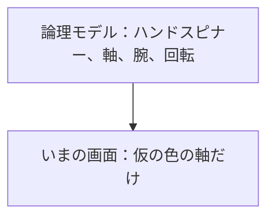
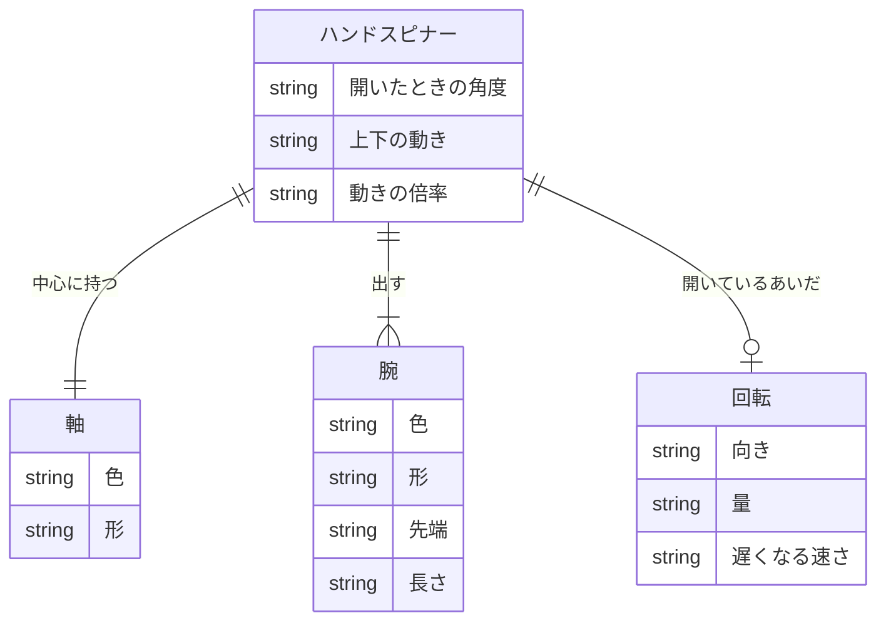
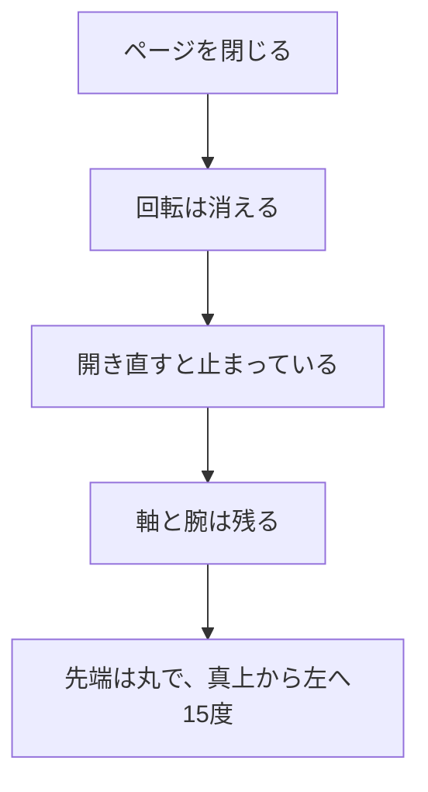

# ER図

| 項目 | 内容 |
|---|---|
| 文書名 | ER図 |
| 対象システム | ハンドスピナー |
| 版 | 1.4 |
| 作成日 | 2026年10月11日 |
| 作成者 | nsb |
| 関連資料 | 要件定義書、機能要件、画面見取り図、ユースケース、データベース設計、`spinner/index.html` |
| 目的 | ハンドスピナー、軸、腕、回転の関係を図で示す |

この資料は、関係の図です。言葉の意味は「要件定義書」の言葉の表に従います。作る範囲の正は「要件定義書」です。

この図は、論理的な関係です。表の項目の正は「データベース設計」です。データベースの製品とファイルは作りません。サーバも作りません。回っていた状態は、ページを閉じると残しません。

---

## 1. この図の位置づけ

| 種類 | 内容 |
|---|---|
| この ER 図 | ハンドスピナー、軸、腕、回転の論理的な関係 |
| いまの画面 | `spinner/index.html`。見えるのは仮の色の軸だけ。腕と回転は、まだない |
| 保存 | しない。ページを閉じると、回転、先端の四角、上下の位置、倍率は残らない |

利用者は、この図のエンティティにしません。ログインがないためです。

---

## 2. 論理 ER 図

ハンドスピナーは1個です。軸は1つ、腕は3本です。回転は、画面を開いているあいだだけ、0または1つです。

---

## 3. エンティティ

| エンティティ | 意味 | 画面上の呼び方 |
|---|---|---|
| ハンドスピナー | 回す物。今回は常に1個 | 画面中央の1個 |
| 軸 | ハンドスピナーの真ん中。回る中心 | 薄い青の丸 |
| 腕 | 軸から外へ伸びる部分。今回は3本 | 濃い黒の腕 |
| 回転 | 回っているあいだの向き、量、遅さ。保存しない | 回っている状態 |

---

## 4. リレーション

| 関係 | 多重度 | 説明 |
|---|---|---|
| ハンドスピナーと軸 | 1 対 1 | ハンドスピナー1個に、軸はちょうど1つ。軸は必ずこのハンドスピナーに属する |
| ハンドスピナーと腕 | 1 対 3 | ハンドスピナー1個に、腕はちょうど3本。腕の追加と削除はしない。3本は等しい間隔 |
| ハンドスピナーと回転 | 1 対 0または1 | 止まっているときは、回転を持たない。ドラッグして離すと、回転を1つ持つ。ページを閉じると、回転は消える |

---

## 5. 属性

| 論理項目 | 内容 | 備考 |
|---|---|---|
| ハンドスピナー.開いたときの角度 | 真上から左へ15度 | 機能要件 H-4 |
| ハンドスピナー.上下の動き | 下画面を押すと上下に動く。いちばん上からいちばん下まで約10cm。一往復は30秒。もう一度押すと、その場で止まる | 機能要件 H-6 |
| ハンドスピナー.動きの倍率 | 左または右を押しているあいだ、1.0倍。離しても1.0倍 | 機能要件 H-7、H-8 |
| 軸.色 | 薄い青 | 機能要件 H-1 |
| 軸.形 | 丸。中心に穴がある | 機能要件 H-1 |
| 腕.色 | 濃い黒 | 機能要件 H-4 |
| 腕.形 | 細い | 機能要件 H-4 |
| 腕.先端 | 開いたときは丸。上画面を押すと四角。もう一度で丸 | 機能要件 H-4、H-5 |
| 腕.長さ | 軸の中心から先端まで約15cm | 機能要件 H-4 |
| 回転.向き | 回した方向 | 画面を開いているあいだだけ。保存しない（機能要件 H-3） |
| 回転.量 | マウスの動かし方で変わる | 同上 |
| 回転.遅くなる速さ | マウスの動かし方で変わる | 同上 |

軸と腕以外のエンティティはありません。背景の白と、倍速ボタンは画面の部品です。この図のエンティティにはしません。

---

## 6. ページを閉じたときの関係

軸と腕は消しません。回転だけが残らない、という約束です（機能要件 H-1、H-4）。

マウスを動かさずにクリックしても、回転は増えず、ある回転も変わりません（機能要件 H-2）。  
ドラッグ中は、回転がマウスの位置へ追いかけません。離したあと、回転を持ちます（機能要件 H-3）。

---

## 7. 改訂履歴

| 版 | 日付 | 内容 |
|---|---|---|
| 1.0 | 2026年10月11日 | 初版。ハンドスピナー、軸、腕、回転の関係を書いた。データベースは入れていない |
| 1.1 | 2026年10月11日 | 角度、色の濃さ、先端の形、上下の動き、倍率を属性に加えた |
| 1.2 | 2026年10月11日 | 上下の幅を約10cm、一往復を30秒、倍率を1.0倍とした |
| 1.3 | 2026年10月11日 | 倍速ボタンは画面の部品であり、エンティティにはしないと書いた |
| 1.4 | 2026年10月11日 | 表の項目の正を、データベース設計にした。製品とファイルは使わない |
