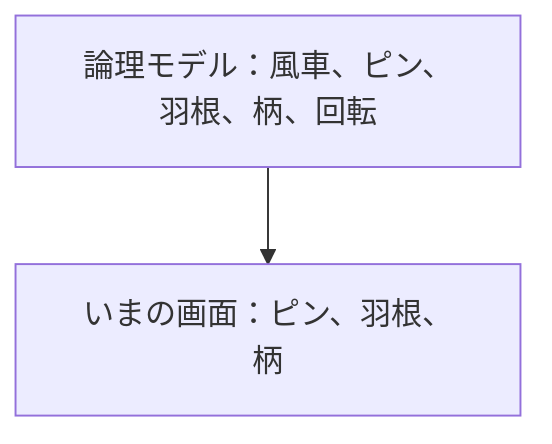
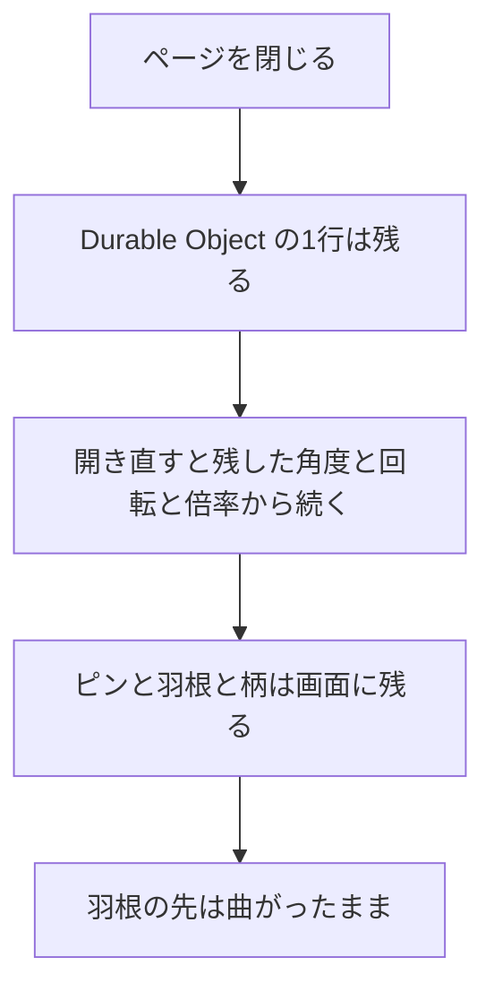

# ER図

| 項目 | 内容 |
|---|---|
| 文書名 | ER図 |
| 対象システム | 風車 |
| 版 | 2.6 |
| 作成日 | 2026年10月11日 |
| 作成者 | nsb |
| 関連資料 | 要件定義書、用語定義書、機能要件、画面見取り図、ユースケース、データベース設計、`spinner/frontend/index.html` |
| 目的 | 風車、軸、腕、回転の関係を図で示す |

この資料は、関係の図です。言葉の意味は「用語定義書」に従います。作る範囲の正は「要件定義書」です。

この図は、論理的な関係です。表の項目の正は「データベース設計」です。データベースは SQLite です。PostgreSQL と RDS は置きません。角度、角速度、倍率は、ログインした人の `pinwheel` の1行に残します。ページを閉じても、その行は残ります。

---

## 1. この図の位置づけ

| 種類 | 内容 |
|---|---|
| この ER 図 | 風車、ピン、羽根、柄、回転の論理的な関係 |
| いまの画面 | `spinner/frontend/index.html`。ピン、曲がった羽根4枚、柄がある |
| 保存 | Durable Object の1行。ページを閉じても、角度、角速度、倍率は残る。羽根の先は曲がったまま、長さは約4.2cm |

利用者は、SQLite の `users` です。ログインのあいだだけ `sessions` を持ちます。風車の変わる値は、その人の `pinwheel` です。



---

## 2. 論理 ER 図

風車は1個です。ピンは1つ、羽根は4枚、柄は1本です。回転は、画面を開いているあいだだけ、0または1つです。

```mermaid
erDiagram
  利用者 ||--o{ セッション : ログインする
  利用者 ||--|| 風車 : 1行を持つ
  風車 ||--|| ピン : 中心に持つ
  風車 ||--|{ 羽根 : 出す
  風車 ||--|| 柄 : 下に持つ
  風車 ||--o| 回転 : 開いているあいだ
  風車 {
    string 開いたときの角度
    string 上下の動き
    string 動きの倍率
  }
  ピン {
    string 色
    string 形
  }
  羽根 {
    string 色
    string 形
    string 先
    string 長さ
  }
  柄 {
    string 色
    string 動き
  }
  回転 {
    string 向き
    string 量
    string 遅くなる速さ
  }
```

---

## 3. エンティティ

| エンティティ | 意味 | 画面上の呼び方 |
|---|---|---|
| 利用者 | 登録した人。`users` の1行 | 画面上の名前 |
| セッション | ログイン中の Cookie。`sessions` の1行 | 画面には出さない |
| 風車 | 回す物。アカウントごとに1個 | 画面中央の1個 |
| ピン | 風車の真ん中。回る中心 | 濃い黒の小さい丸 |
| 羽根 | ピンから外へ伸びる部分。今回は4枚 | 赤、青、黄、緑の薄い羽根 |
| 柄 | ピンの下の棒。回らない | 木の色の柄 |
| 回転 | 回っているあいだの向き、量、遅さ。Durable Object に残す | 回っている状態 |

---

## 4. リレーション

| 関係 | 多重度 | 説明 |
|---|---|---|
| 利用者とセッション | 1 対 0以上 | ログインすると1行増える。ログアウトするか、期限が切れると消える |
| 利用者と風車 | 1 対 1 | 登録すると `pinwheel` が1行できる。他の人の行は見せない |
| 風車とピン | 1 対 1 | 風車1個に、ピンはちょうど1つ。ピンは必ずこの風車に属する |
| 風車と羽根 | 1 対 4 | 風車1個に、羽根はちょうど4枚。羽根の追加と削除はしない。4枚は等しい間隔 |
| 風車と柄 | 1 対 1 | 風車1個に、柄はちょうど1本。柄は回らない |
| 風車と回転 | 1 対 0または1 | 止まっているときは、回転を持たない。クリックすると、回転を1つ持つ。ページを閉じると、回転は消える |

---

## 5. 属性

| 論理項目 | 内容 | 備考 |
|---|---|---|
| 風車.開いたときの角度 | 真上から左へ15度 | 機能要件 H-4 |
| 風車.上下の動き | 上画面、左画面、右画面、風車以外の下画面を押すと、回転が止まる | 機能要件 H-6 |
| 風車.動きの倍率 | 開いたときは1.0倍。上画面を押すと2.0倍。羽根の長さは約4.2cmのまま。もう一度押すと1.0倍。柄の長さは変わらない | 機能要件 H-5 |
| ピン.色 | 濃い黒 | 機能要件 H-1 |
| ピン.形 | 小さい丸 | 機能要件 H-1 |
| 羽根.色 | 赤、青、黄、緑 | 機能要件 H-4 |
| 羽根.形 | 薄い。少し曲がっている | 機能要件 H-4 |
| 羽根.先 | 曲がった羽根の端 | 機能要件 H-4 |
| 羽根.長さ | 約4.2cmのまま。2.0倍でも変わらない | 機能要件 H-4、H-5 |
| 柄.色 | 木の色 | 機能要件 H-4 |
| 柄.動き | 回らない。長さは変わらない | 機能要件 H-1、H-4 |
| 回転.向き | 止まっているときに風車の上をクリックすると時計回り。右画面も時計回り。左画面は逆回転 | Durable Object の `omega` に残す（機能要件 H-2、H-7、H-8） |
| 回転.量 | 止まっているときにクリックすると回り続ける。回っているときにクリックすると止まる。マウスの動かし方では変わらない | 機能要件 H-2 |
| 回転.遅くなる速さ | 使わない。上画面、左画面、右画面、風車以外を押すと、その場で止まる | 機能要件 H-6 |

SQL に残すのは、利用者、セッション、風車の角度と角速度と倍率です。ピンと羽根と柄は画面の部品です。背景の白は画面の地であり、この図のエンティティにはしません。

---

## 6. ページを閉じたときの関係



ピンと羽根と柄は画面に残します。角度、角速度、倍率は Durable Object に残します（機能要件 H-1、H-4）。

風車の上をクリックすると、止まっていれば時計回りに回り、回っていればその場で止まります（機能要件 H-2）。左画面を押すと逆回転、右画面を押すと時計回りに回ります（機能要件 H-7、H-8）。  
ドラッグしても、回転は変わりません（機能要件 H-3）。

---

## 7. 改訂履歴

| 版 | 日付 | 内容 |
|---|---|---|
| 1.0 | 2026年10月11日 | 初版。ハンドスピナー、軸、腕、回転の関係を書いた。データベースは入れていない |
| 1.1 | 2026年10月11日 | 角度、色の濃さ、先端の形、上下の動き、倍率を属性に加えた |
| 1.2 | 2026年10月11日 | 上下の幅を約10cm、一往復を30秒、倍率を1.0倍とした |
| 1.3 | 2026年10月11日 | 倍速ボタンは画面の部品であり、エンティティにはしないと書いた |
| 1.4 | 2026年10月11日 | 表の項目の正を、データベース設計にした。製品とファイルは使わない |
| 1.5 | 2026年10月13日 | 腕の形と長さ、回転の止まり方、0.5倍と2.5倍を、要件定義書 2.6 に合わせた |
| 1.6 | 2026年10月16日 | 倍率を上画面の2.0倍とし、先端は丸、長さは約4.2cmのままとした。要件定義書 2.9 に合わせた |
| 1.7 | 2026年10月16日 | 回転の向きに逆回転を加えた。要件定義書 3.0 に合わせた |
| 1.8 | 2026年10月16日 | 2.0倍のあいだ腕の長さが変わることを、要件定義書 3.1 に合わせた |
| 1.9 | 2026年10月16日 | ハンドスピナーのクリックで回り、回っていれば止まることを、要件定義書 3.2 に合わせた |
| 2.0 | 2026年10月16日 | 言葉の意味の正を、用語定義書にした |
| 2.1 | 2026年10月17日 | バックエンドを置いても、関係の行は残さないことを、要件定義書 4.1 に合わせた |
| 2.2 | 2026年10月18日 | 呼び方を風車にした。要件定義書 4.2 に合わせた |
| 2.3 | 2026年10月20日 | 関係を、ピン、羽根4枚、柄にした。要件定義書 4.3 に合わせた |
| 2.4 | 2026年10月20日 | 2.0倍のあいだ、羽根の長さを変えないことにした。要件定義書 4.5 に合わせた |
| 2.5 | 2026年10月22日 | 角度、角速度、倍率を Durable Object に残す。要件定義書 4.7 に合わせた |
| 2.6 | 2026年10月23日 | 利用者とセッションを加え、風車をアカウントごとの1行にした。要件定義書 4.8 に合わせた |
