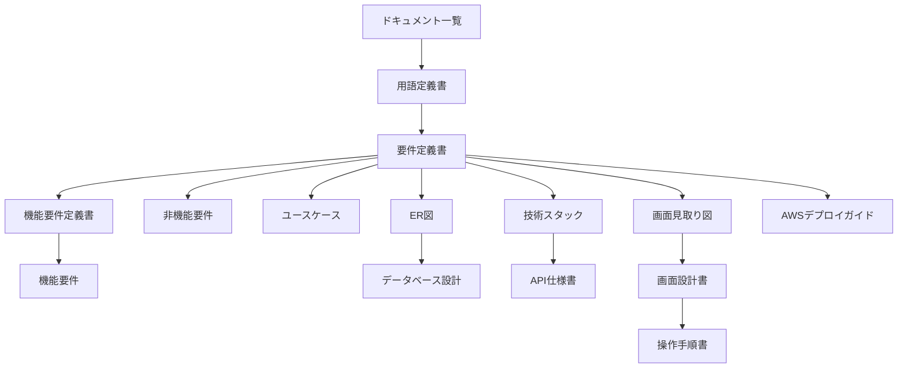

# ドキュメント一覧

| 項目 | 内容 |
|---|---|
| 文書名 | ドキュメント一覧 |
| 対象システム | 風車 |
| 版 | 2.0 |
| 作成日 | 2026年10月17日 |
| 作成者 | nsb |
| 関連資料 | 用語定義書、要件定義書、機能要件定義書、機能要件、非機能要件、ユースケース、ER図、データベース設計、技術スタック、API仕様書、画面見取り図、画面設計書、操作手順書、`spinner/frontend/index.html` |
| 目的 | 資料を、どの順で読むかと、役割で引けるようにする |

この資料は、資料の入口です。何を作るか、何を作らないかの正は「要件定義書」です。言葉の意味の正は「用語定義書」です。

利用者は、登録した人です。フロントエンドは `spinner/frontend/index.html` の1枚です。バックエンドの言語は JavaScript、フレームワークは Hono です。ファイルは `spinner/backend/worker.js` で、実行環境は Cloudflare Workers です。データベースの言語は SQL、製品は SQLite です。ファイルは `spinner/durable-object/pinwheel.js` で、実行環境は Durable Object のストレージです。確認用の EC2 は、2026年10月20日に消しました。作り直す手順は AWSデプロイガイドです。PostgreSQL と RDS は置きません。請求は 0 円です。

| 層 | 言語 | フレームワークまたは製品 | 場所 | いまあるもの |
|---|---|---|---|---|
| フロントエンド | HTML、CSS、JavaScript | なし | `spinner/frontend/index.html` | ログイン欄、ピン、曲がった羽根4枚、柄、左の↺、右の↻ |
| バックエンド | JavaScript | Hono | `spinner/backend/worker.js` | `/api/` を SQLite へ渡す。実行環境は Workers。`127.0.0.1:8787` |
| データベース | SQL | SQLite | `spinner/durable-object/pinwheel.js` | `users`、`sessions`、アカウントごとの `pinwheel` |
| 資料 | | | `spinner/ドキュメント` | 言葉、範囲、機能、画面、データ、技術、API、手順 |

---

## 1. どの順で読むか

初めて読むときは上から順に見ます。目的が決まっているときは、次の節のグループから入ってください。

| 順番 | 資料 | 役割 |
|---|---|---|
| 1 | [用語定義書.md](./用語定義書.md) | 風車、軸、腕、回転などの呼び方 |
| 2 | [要件定義書.md](./要件定義書.md) | 何を作るか、何を作らないか。番号の正は H-1 から H-8 と A-1 から A-3。完成の定義がある |
| 3 | [機能要件定義書.md](./機能要件定義書.md) | きっかけ、処理、事後条件 |
| 4 | [機能要件.md](./機能要件.md) | H-1 から H-8 と、A-1 から A-3 を引く一覧 |
| 5 | [非機能要件.md](./非機能要件.md) | 環境、残し方、費用、速さ |
| 6 | [ユースケース.md](./ユースケース.md) | 利用の流れ。UC-1 から UC-11 |
| 7 | [ER図.md](./ER図.md) | 風車、軸、腕、回転の関係の図 |
| 8 | [データベース設計.md](./データベース設計.md) | SQLite の `users`、`sessions`、`pinwheel` |
| 9 | [技術スタック.md](./技術スタック.md) | 言語、フレームワーク、データベース、実行環境 |
| 10 | [API仕様書.md](./API仕様書.md) | `/api/` のパス、本体、状態コード |
| 11 | [画面見取り図.md](./画面見取り図.md) | どこに何を置くかの図 |
| 12 | [画面設計書.md](./画面設計書.md) | 部品の位置、表示、押したときの動き。画面IDは SCR-01 |
| 13 | [操作手順書.md](./操作手順書.md) | `spinner/frontend/index.html` の開き方と、押したときの手順 |
| 14 | [AWSデプロイガイド.md](./AWSデプロイガイド.md) | 東京の EC2 に載せ、消したあとに作り直す手順 |

---

## 2. 目的から資料を選ぶ

### 言葉と範囲

呼び方は用語定義書です。何を作るか、何を作らないか、完成とみなす条件は要件定義書です。できることの定義は機能要件定義書、番号で引く一覧は機能要件です。環境、残し方、費用、速さは非機能要件です。

### 利用の流れ

開く、ドラッグ、クリック、上画面、下画面、左画面、右画面、開き直す流れはユースケースです。

### データ

関係の図は ER図です。表の項目はデータベース設計です。角度、角速度、倍率は、ログインした人の SQLite の1行に残します。ページを閉じても、その行は残ります。羽根の長さは約4.2cmのままです。

### 技術

使うものと使わないものは技術スタックです。フロントエンドの言語は HTML、CSS、JavaScript で、フレームワークはありません。バックエンドの言語は JavaScript、フレームワークは Hono、実行環境は Cloudflare Workers です。データベースは SQLite で、実行環境は Durable Object のストレージです。パスは API仕様書です。`npx wrangler dev` のあと、`http://127.0.0.1:8787` を開きます。EC2 は消してあります。作り直す手順は AWSデプロイガイドです。

### 画面

先に形をつかむときは画面見取り図です。部品の表は画面設計書です。開き方と、押したときの手順は操作手順書です。

---

## 3. 資料の関係

図は GitHub 向けの Mermaid です。コードブロックの言語名を mermaid にし、流れは `flowchart`、データの関係は `erDiagram` で書いています。GitHub で Markdown を開くと図として見られます。

---

## 4. 資料を分けた経緯

| 日付 | 内容 |
|---|---|
| 2026年10月11日 | 要件定義書、機能要件、画面見取り図、ER図、ユースケース、データベース設計、技術スタックの初版 |
| 2026年10月16日 | 用語定義書、機能要件定義書、画面設計書。画面の操作を、いまの H-1 から H-8 に合わせた |
| 2026年10月17日 | 操作手順書、非機能要件、この一覧。アプリケーションの React、TypeScript、Vite、Tailwind、Java、Spring Boot、Gradle、PostgreSQL は使わない |

---

## 5. 改訂履歴

| 版 | 日付 | 内容 |
|---|---|---|
| 1.0 | 2026年10月17日 | 初版。用語定義書から操作手順書まで、読む順と役割を書いた |
| 1.1 | 2026年10月17日 | 要件定義書の役割に、完成の定義を加えた |
| 1.2 | 2026年10月17日 | フロントエンドとバックエンドの役割を、要件定義書 4.1 に合わせた |
| 1.3 | 2026年10月18日 | 呼び方を風車にした。要件定義書 4.2 に合わせた |
| 1.4 | 2026年10月18日 | バックエンドの `spinner/server.js` を、いまあるものにした |
| 1.5 | 2026年10月20日 | フロントエンドの説明を、ピン、羽根、柄にした。要件定義書 4.3 に合わせた |
| 1.6 | 2026年10月20日 | 読む順に、AWSデプロイガイドを加えた。要件定義書 4.4 に合わせた |
| 1.7 | 2026年10月20日 | 2.0倍のあいだ、羽根の長さを変えないことにした。要件定義書 4.5 に合わせた |
| 1.8 | 2026年10月20日 | 確認用の EC2 を消した状態にした。要件定義書 4.6 に合わせた |
| 1.9 | 2026年10月22日 | バックエンドを Workers、状態を Durable Object にした。要件定義書 4.7 に合わせた |
| 2.0 | 2026年10月23日 | 言語、フレームワーク、SQLite を分け、API仕様書を読む順に加えた。要件定義書 4.8 に合わせた |
