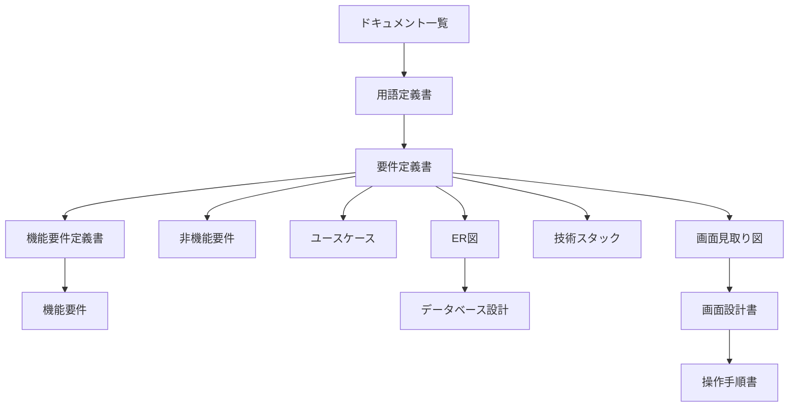

# ドキュメント一覧

| 項目 | 内容 |
|---|---|
| 文書名 | ドキュメント一覧 |
| 対象システム | ハンドスピナー |
| 版 | 1.2 |
| 作成日 | 2026年10月17日 |
| 作成者 | nsb |
| 関連資料 | 用語定義書、要件定義書、機能要件定義書、機能要件、非機能要件、ユースケース、ER図、データベース設計、技術スタック、画面見取り図、画面設計書、操作手順書、`spinner/index.html` |
| 目的 | 資料を、どの順で読むかと、役割で引けるようにする |

この資料は、資料の入口です。何を作るか、何を作らないかの正は「要件定義書」です。言葉の意味の正は「用語定義書」です。

対象は nsb 一人です。フロントエンドは `spinner/index.html` の1枚です。バックエンドは `spinner/server.js` で、`http://127.0.0.1:3000` にそのファイルを渡します。データベースの製品も、有料のサービスも使いません。費用は 0 円です。

| 層 | 場所 | いまあるもの |
|---|---|---|
| フロントエンド | `spinner/index.html` | 軸、つながった腕3本、先端、左の↺、右の↻。クリックで回り、もう一度で止まる |
| バックエンド | `spinner/server.js` | まだ無い。Node.js で、フロントエンドを `127.0.0.1:3000` へ渡す |
| 資料 | `spinner/ドキュメント` | 言葉、範囲、機能、画面、データ、技術、手順 |

---

## 1. どの順で読むか

初めて読むときは上から順に見ます。目的が決まっているときは、次の節のグループから入ってください。

| 順番 | 資料 | 役割 |
|---|---|---|
| 1 | [用語定義書.md](./用語定義書.md) | ハンドスピナー、軸、腕、回転などの呼び方 |
| 2 | [要件定義書.md](./要件定義書.md) | 何を作るか、何を作らないか。番号の正は H-1 から H-8。完成の定義がある |
| 3 | [機能要件定義書.md](./機能要件定義書.md) | きっかけ、処理、事後条件 |
| 4 | [機能要件.md](./機能要件.md) | H-1 から H-8 を引く一覧 |
| 5 | [非機能要件.md](./非機能要件.md) | 環境、残し方、費用、速さ |
| 6 | [ユースケース.md](./ユースケース.md) | 利用の流れ。UC-1 から UC-8 |
| 7 | [ER図.md](./ER図.md) | ハンドスピナー、軸、腕、回転の関係の図 |
| 8 | [データベース設計.md](./データベース設計.md) | 表の項目。製品とファイルは使わない |
| 9 | [技術スタック.md](./技術スタック.md) | 採用する技術と、採用しない技術 |
| 10 | [画面見取り図.md](./画面見取り図.md) | どこに何を置くかの図 |
| 11 | [画面設計書.md](./画面設計書.md) | 部品の位置、表示、押したときの動き。画面IDは SCR-01 |
| 12 | [操作手順書.md](./操作手順書.md) | `spinner/index.html` の開き方と、押したときの手順 |

---

## 2. 目的から資料を選ぶ

### 言葉と範囲

呼び方は用語定義書です。何を作るか、何を作らないか、完成とみなす条件は要件定義書です。できることの定義は機能要件定義書、番号で引く一覧は機能要件です。環境、残し方、費用、速さは非機能要件です。

### 利用の流れ

開く、ドラッグ、クリック、上画面、下画面、左画面、右画面、開き直す流れはユースケースです。

### データ

関係の図は ER図です。表の項目はデータベース設計です。この版では、表をファイルには書きません。ページを閉じると、回転、倍率、腕の長さの変化は残りません。

### 技術

使うものと使わないものは技術スタックです。フロントエンドは HTML、CSS、JavaScript です。バックエンドは Node.js です。`node server.js` のあと、`http://127.0.0.1:3000` を開きます。

### 画面

先に形をつかむときは画面見取り図です。部品の表は画面設計書です。開き方と、押したときの手順は操作手順書です。

---

## 3. 資料の関係

図は GitHub 向けの Mermaid です。コードブロックの言語名を mermaid にし、流れは `flowchart`、データの関係は `erDiagram` で書いています。GitHub で Markdown を開くと図として見られます。

---

## 4. 資料を分けた経緯

| 日付 | 内容 |
|---|---|
| 2026年10月11日 | 要件定義書、機能要件、画面見取り図、ER図、ユースケース、データベース設計、技術スタックの初版 |
| 2026年10月16日 | 用語定義書、機能要件定義書、画面設計書。画面の操作を、いまの H-1 から H-8 に合わせた |
| 2026年10月17日 | 操作手順書、非機能要件、この一覧。アプリケーションの React、TypeScript、Vite、Tailwind、Java、Spring Boot、Gradle、PostgreSQL は使わない |

---

## 5. 改訂履歴

| 版 | 日付 | 内容 |
|---|---|---|
| 1.0 | 2026年10月17日 | 初版。用語定義書から操作手順書まで、読む順と役割を書いた |
| 1.1 | 2026年10月17日 | 要件定義書の役割に、完成の定義を加えた |
| 1.2 | 2026年10月17日 | フロントエンドとバックエンドの役割を、要件定義書 4.1 に合わせた |
