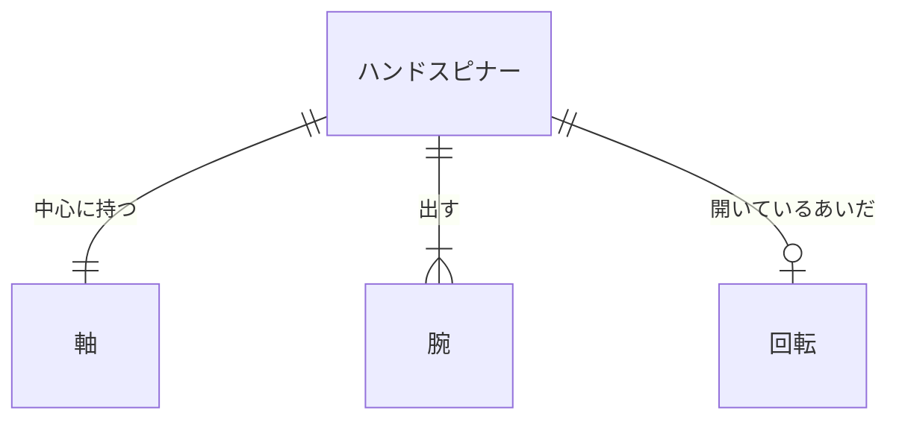
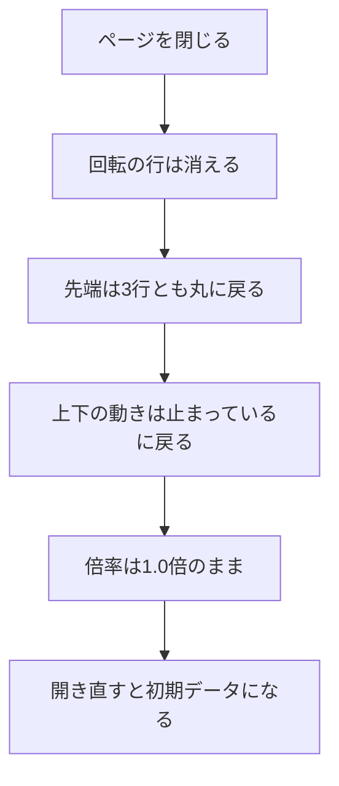

# データベース設計

| 項目 | 内容 |
|---|---|
| 文書名 | データベース設計 |
| 対象システム | ハンドスピナー |
| 版 | 1.1 |
| 作成日 | 2026年10月11日 |
| 作成者 | nsb |
| 関連資料 | 要件定義書、機能要件、ER図、技術スタック、`spinner/index.html` |
| 目的 | ハンドスピナー、軸、腕、回転を表にしたときの項目と約束を決める |

関係の図は「ER図」を正とします。言葉の意味は「要件定義書」の言葉の表に従います。

この版では、データベースの製品を使いません。サーバも作りません。採用する技術の正は「技術スタック」です。表は、論理的な項目の約束です。ファイルには書きません。費用は 0 円です。

ページを閉じると、回転、先端の四角、上下の位置、倍率の変化は残しません。開き直すと、初期データの並びに戻ります。

この資料での呼び方は、次のとおりです。

| 呼び方 | 意味 |
|---|---|
| 表 | 同じ種類の行を並べたもの。この版では、ファイルには作らない |
| 主キー | その表の中で、1行を区別する項目 |
| 外部キー | 親の表の行を指す項目 |

背景の白と、倍速ボタンは、表にしません。画面の部品であるためです。

---

## 1. 表の一覧

| 表 | 主キー | 外部キー | 行数 |
|---|---|---|---|
| ハンドスピナー | 識別子 | なし | この版では1行 |
| 軸 | 識別子 | ハンドスピナーの識別子 | この版では1行 |
| 腕 | 識別子 | ハンドスピナーの識別子 | この版では3行 |
| 回転 | 識別子 | ハンドスピナーの識別子 | 止まっているときは0行。回っているときは1行 |

識別子は、行を区別する番号です。この版では、ファイルに持ちません。画面上の部品そのものが、行に当たります。

---

## 2. ハンドスピナー

| 項目 | 型 | 必須 | 約束 |
|---|---|---|---|
| 識別子 | 識別子 | 必須 | 主キー。この表の中で重複しない |
| 開いたときの角度 | 文字列 | 必須 | 真上から左へ15度。書き換えない（機能要件 H-4） |
| 上下の動き | 文字列 | 必須 | 開いたときは「止まっている」。下画面を押すと「動いている」。もう一度押すと「止まっている」。動く幅は約10cm。一往復は30秒（機能要件 H-6） |
| 動きの倍率 | 文字列 | 必須 | 1.0倍。左または右の倍速ボタンを押しても、離しても、1.0倍のまま（機能要件 H-7、H-8） |

行の追加と削除はしません。この版では、常に1行です。

---

## 3. 軸

| 項目 | 型 | 必須 | 約束 |
|---|---|---|---|
| 識別子 | 識別子 | 必須 | 主キー。この表の中で重複しない |
| ハンドスピナーの識別子 | 識別子 | 必須 | 外部キー。親はハンドスピナーの1行 |
| 色 | 文字列 | 必須 | 薄い青。書き換えない（機能要件 H-1） |
| 形 | 文字列 | 必須 | 丸。中心に穴がある。書き換えない（機能要件 H-1） |

軸の追加と削除はしません。この版では、常に1行です。

---

## 4. 腕

| 項目 | 型 | 必須 | 約束 |
|---|---|---|---|
| 識別子 | 識別子 | 必須 | 主キー。この表の中で重複しない |
| ハンドスピナーの識別子 | 識別子 | 必須 | 外部キー。親はハンドスピナーの1行。腕は必ずこのハンドスピナーに属する |
| 位置 | 整数 | 必須 | 軸の周りの順番。この版では 1、2、3。同じハンドスピナーの中で重複しない |
| 色 | 文字列 | 必須 | 濃い黒。書き換えない（機能要件 H-4） |
| 形 | 文字列 | 必須 | 細い。書き換えない（機能要件 H-4） |
| 先端 | 文字列 | 必須 | 開いたときは「丸」。上画面を押すと、3行とも「四角」。もう一度押すと、3行とも「丸」（機能要件 H-5） |
| 長さ | 文字列 | 必須 | 軸の中心から先端まで約15cm。書き換えない（機能要件 H-4） |

3行は、軸の周りに等しい間隔です。開いたときの向きは、ハンドスピナーの角度に従います。腕の追加と削除はしません。

---

## 5. 回転

| 項目 | 型 | 必須 | 約束 |
|---|---|---|---|
| 識別子 | 識別子 | 必須 | 主キー。この表の中で重複しない |
| ハンドスピナーの識別子 | 識別子 | 必須 | 外部キー。親はハンドスピナーの1行。回転は最大1行 |
| 向き | 文字列 | 必須 | 回した方向（機能要件 H-3） |
| 量 | 文字列 | 必須 | マウスの動かし方で変わる（機能要件 H-3） |
| 遅くなる速さ | 文字列 | 必須 | マウスの動かし方で変わる（機能要件 H-3） |

止まっているときは、行を持ちません。ドラッグして離すと、1行を持ちます。押している間は、マウスの位置へ追いかけません。ハンドスピナーの上で、マウスを動かさずにクリックしても、行は増えず、ある行も変わりません（機能要件 H-2）。

この表は、ファイルに書きません。ページを閉じると、行は消えます。

---

## 6. 初期データ

画面を開いたときの行は、次のとおりです。ページを閉じると、この並びに戻ります。

| 表 | 内容 |
|---|---|
| ハンドスピナー | 1行。角度は真上から左へ15度。上下の動きは止まっている。倍率は1.0倍 |
| 軸 | 1行。色は薄い青。形は丸で、中心に穴がある |
| 腕 | 3行。位置は1、2、3。色は濃い黒。形は細い。先端は丸。長さは約15cm |
| 回転 | 0行 |

---

## 7. ページを閉じたとき

軸の行と、腕の3行と、ハンドスピナーの1行は、消しません。残さないのは、回していた状態と、押したあとの変化です。

---

## 8. いまの画面との対応

| 論理項目 | いまの `spinner/index.html` |
|---|---|
| 軸 | 画面の中央に、仮の銀と黒の丸がある。約束の薄い青には、まだしていない |
| 腕 | まだない |
| 回転 | まだない |
| ハンドスピナー.開いたときの角度 | まだない |
| 倍速ボタン | まだない。表にもしない |
| 各表の識別子 | 持たない |

いまの画面は、この表へ書きません。

---

## 9. 改訂履歴

| 版 | 日付 | 内容 |
|---|---|---|
| 1.0 | 2026年10月11日 | 初版。ハンドスピナー、軸、腕、回転の項目と約束を書いた。製品とファイルは使わない |
| 1.1 | 2026年10月11日 | 製品を使わないことの正を、技術スタックにした |
