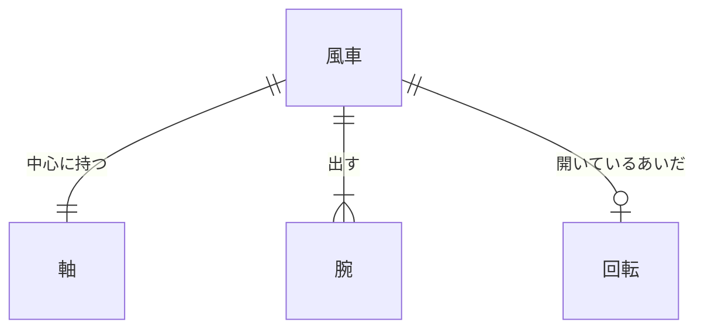
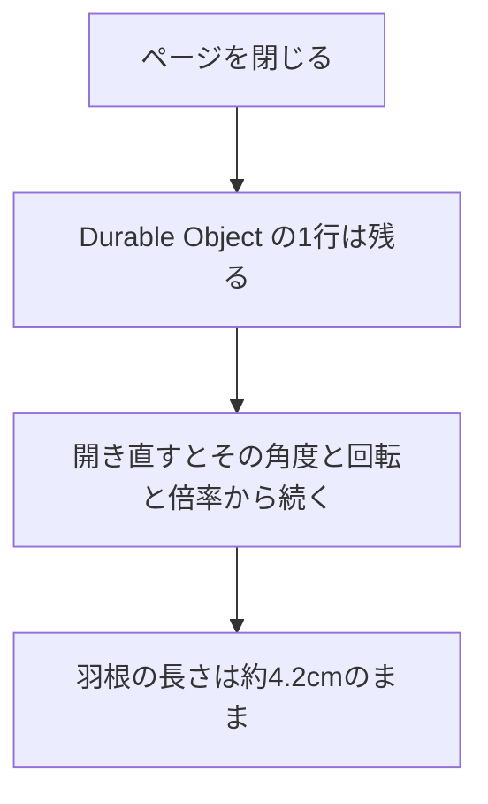

# データベース設計

| 項目 | 内容 |
|---|---|
| 文書名 | データベース設計 |
| 対象システム | 風車 |
| 版 | 2.3 |
| 作成日 | 2026年10月11日 |
| 作成者 | nsb |
| 関連資料 | 要件定義書、用語定義書、機能要件、ER図、技術スタック、`spinner/frontend/index.html`、`spinner/durable-object/pinwheel.js` |
| 目的 | 風車、軸、腕、回転を表にしたときの項目と約束を決める |

関係の図は「ER図」を正とします。言葉の意味は「用語定義書」に従います。

この版では、PostgreSQL、RDS、ファイルの SQLite は置きません。向き、回転、倍率は、Durable Object の表 `pinwheel` の1行に残します。中のストレージは Durable Object の SQLite です。採用する技術の正は「技術スタック」です。風車、ピン、羽根、柄の見た目は、フロントエンドの画面にあります。費用は 0 円です。

ページを閉じても、Durable Object の1行は残ります。開き直すと、その角度、角速度、倍率から続きます。羽根の先は曲がったまま、長さは約4.2cmのままです。行がまだ無いときだけ、初期データの並びにします。

この資料での呼び方は、次のとおりです。

| 呼び方 | 意味 |
|---|---|
| 表 | 同じ種類の行を並べたもの。変わる値は Durable Object の `pinwheel` に1行で残す |
| 主キー | その表の中で、1行を区別する項目 |
| 外部キー | 親の表の行を指す項目 |

背景の白は、表にしません。画面の地の色であるためです。

---

## 1. 表の一覧

| 表 | 主キー | 外部キー | 行数 |
|---|---|---|---|
| 風車 | 識別子 | なし | この版では1行 |
| 軸 | 識別子 | 風車の識別子 | この版では1行 |
| 腕 | 識別子 | 風車の識別子 | この版では3行 |
| 回転 | 識別子 | 風車の識別子 | 止まっているときは0行。回っているときは1行 |

識別子は、行を区別する番号です。Durable Object の行は、`id = 1` の1行です。見た目の部品は、画面上の部品そのものが行に当たります。

---

## 2. 風車

| 項目 | 型 | 必須 | 約束 |
|---|---|---|---|
| 識別子 | 識別子 | 必須 | 主キー。この表の中で重複しない |
| 開いたときの角度 | 文字列 | 必須 | 真上から左へ15度。書き換えない（機能要件 H-4） |
| 上下の動き | 文字列 | 必須 | 上画面、左画面、右画面、風車以外の下画面を押すと、回転が止まる（機能要件 H-6） |
| 動きの倍率 | 文字列 | 必須 | 開いたときは1.0倍。上画面を押すと2.0倍。もう一度押すと1.0倍（機能要件 H-5） |

行の追加と削除はしません。この版では、常に1行です。

---

## 3. 軸

| 項目 | 型 | 必須 | 約束 |
|---|---|---|---|
| 識別子 | 識別子 | 必須 | 主キー。この表の中で重複しない |
| 風車の識別子 | 識別子 | 必須 | 外部キー。親は風車の1行 |
| 色 | 文字列 | 必須 | 濃い黒。書き換えない（機能要件 H-1） |
| 形 | 文字列 | 必須 | 丸。中心に穴がある。書き換えない（機能要件 H-1） |

軸の追加と削除はしません。この版では、常に1行です。

---

## 4. 腕

| 項目 | 型 | 必須 | 約束 |
|---|---|---|---|
| 識別子 | 識別子 | 必須 | 主キー。この表の中で重複しない |
| 風車の識別子 | 識別子 | 必須 | 外部キー。親は風車の1行。腕は必ずこの風車に属する |
| 位置 | 整数 | 必須 | 軸の周りの順番。この版では 1、2、3。同じ風車の中で重複しない |
| 色 | 文字列 | 必須 | 濃い黒。書き換えない（機能要件 H-4） |
| 形 | 文字列 | 必須 | 薄い。少し曲がっている。書き換えない（機能要件 H-4） |
| 先 | 文字列 | 必須 | 曲がった羽根の端。書き換えない（機能要件 H-4） |
| 長さ | 文字列 | 必須 | 約4.2cmのまま。2.0倍でも変わらない（機能要件 H-4、H-5） |

3行は、軸の周りに等しい間隔です。開いたときの向きは、風車の角度に従います。腕の追加と削除はしません。

---

## 5. 回転

| 項目 | 型 | 必須 | 約束 |
|---|---|---|---|
| 識別子 | 識別子 | 必須 | 主キー。この表の中で重複しない |
| 風車の識別子 | 識別子 | 必須 | 外部キー。親は風車の1行。回転は最大1行 |
| 向き | 文字列 | 必須 | 止まっているときに風車の上をクリックすると時計回り。右画面も時計回り。左画面は逆回転（機能要件 H-2、H-7、H-8） |
| 量 | 文字列 | 必須 | 止まっているときにクリックすると回り続ける。回っているときにクリックすると止まる。マウスの動かし方では変わらない（機能要件 H-2） |
| 遅くなる速さ | 文字列 | 必須 | 使わない。上画面、左画面、右画面、風車以外を押すと、その場で止まる（機能要件 H-6） |

止まっているときは、行を持ちません。止まっているときにクリックすると、1行を持ちます。回っているときにクリックすると、行は消えます。ドラッグしても、行は増えず、ある行も変わりません（機能要件 H-2、H-3）。

この表の変わる値は、Durable Object の `pinwheel` に書きます。列は `angle`、`omega`、`speed` です。ページを閉じても、行は消えません。

---

## 6. 初期データ

Durable Object に行がまだ無いときだけ、次の並びにします。ページを閉じても、書いたあとの行は残ります。

| 表 | 内容 |
|---|---|
| 風車 | 1行。角度は真上から左へ15度。回転は止まっている。倍率は1.0倍 |
| ピン | 1行。色は濃い黒。形は小さい丸 |
| 羽根 | 4行。位置は1、2、3、4。色は赤、青、黄、緑。形は薄い。先は曲がった羽根の端。長さは約4.2cm |
| 柄 | 1行。色は木の色。回らない |
| 回転 | 0行 |

---

## 7. ページを閉じたとき

ピン、羽根、柄は画面に残します。角度、角速度、倍率は Durable Object に残します。

---

## 8. いまの画面との対応

| 論理項目 | いまの実装 |
|---|---|
| ピン | 画面の中央に、濃い黒の小さい丸がある |
| 羽根 | 4枚。赤、青、黄、緑。薄く、少し曲がる。長さは約4.2cmのまま。先は曲がった羽根の端 |
| 柄 | ピンの下。木の色。回らない。長さは変わらない |
| 回転 | 止まっているときに風車の上をクリックすると時計回り。回っているときにクリックすると止まる。右画面は時計回り。左画面は逆回転。上画面、左画面、右画面、風車以外を押すと止まる |
| 風車.開いたときの角度 | 真上から左へ15度 |
| 風車.動きの倍率 | 開いたときは1.0倍。上画面を押すと2.0倍。もう一度押すと1.0倍 |
| 各表の識別子 | Durable Object の行は `id = 1`。見た目の部品は画面上にある |
| 角度、角速度、倍率 | `spinner/durable-object/pinwheel.js` の表 `pinwheel` |

バックエンドは `/api/state` をこの行へ渡します。画面は、開いたときにその行を読み、操作のたびに書き戻します。

---

## 9. 改訂履歴

| 版 | 日付 | 内容 |
|---|---|---|
| 1.0 | 2026年10月11日 | 初版。ハンドスピナー、軸、腕、回転の項目と約束を書いた。製品とファイルは使わない |
| 1.1 | 2026年10月11日 | 製品を使わないことの正を、技術スタックにした |
| 1.2 | 2026年10月13日 | 腕の形と長さ、回転、倍率を、要件定義書 2.6 に合わせた。画面にも、その約束がある |
| 1.3 | 2026年10月16日 | 倍率を上画面の2.0倍とし、先端は丸、長さは約4.2cmのままとした。要件定義書 2.9 に合わせた |
| 1.4 | 2026年10月16日 | 回転の向きに逆回転を加えた。要件定義書 3.0 に合わせた |
| 1.5 | 2026年10月16日 | 2.0倍のあいだ腕の長さが変わることを、要件定義書 3.1 に合わせた |
| 1.6 | 2026年10月16日 | ハンドスピナーのクリックで回り、回っていれば止まることを、要件定義書 3.2 に合わせた |
| 1.7 | 2026年10月16日 | 言葉の意味の正を、用語定義書にした |
| 1.8 | 2026年10月17日 | アプリケーションの PostgreSQL は使わないことを、技術スタック 1.8 に合わせた |
| 1.9 | 2026年10月17日 | バックエンドを置いても、表へは書かないことを、要件定義書 4.1 に合わせた |
| 2.0 | 2026年10月18日 | 呼び方を風車にした。要件定義書 4.2 に合わせた |
| 2.1 | 2026年10月20日 | 初期データを、ピン、羽根4枚、柄にした。要件定義書 4.3 に合わせた |
| 2.2 | 2026年10月20日 | 2.0倍のあいだ、羽根の長さを変えないことにした。要件定義書 4.5 に合わせた |
| 2.3 | 2026年10月22日 | 角度、角速度、倍率を Durable Object の1行に残す。要件定義書 4.7 に合わせた |
