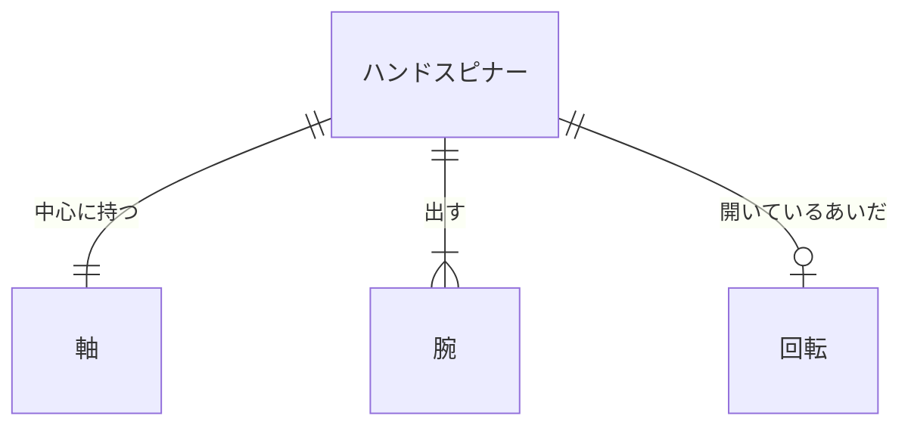
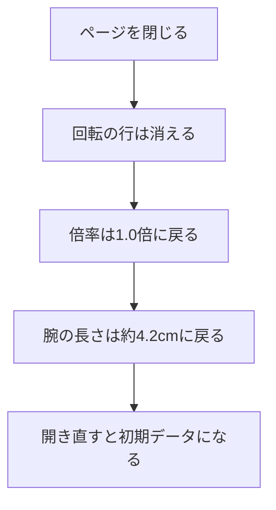

# データベース設計

| 項目 | 内容 |
|---|---|
| 文書名 | データベース設計 |
| 対象システム | ハンドスピナー |
| 版 | 1.9 |
| 作成日 | 2026年10月11日 |
| 作成者 | nsb |
| 関連資料 | 要件定義書、用語定義書、機能要件、ER図、技術スタック、`spinner/index.html` |
| 目的 | ハンドスピナー、軸、腕、回転を表にしたときの項目と約束を決める |

関係の図は「ER図」を正とします。言葉の意味は「用語定義書」に従います。

この版では、データベースの製品を使いません。アプリケーションで使った PostgreSQL も使いません。バックエンドは画面のファイルを渡すだけで、表へは書きません。採用する技術の正は「技術スタック」です。表は、論理的な項目の約束です。ファイルには書きません。費用は 0 円です。

ページを閉じると、回転、倍率、腕の長さの変化は残しません。先端は丸です。開き直すと、初期データの並びに戻ります。

この資料での呼び方は、次のとおりです。

| 呼び方 | 意味 |
|---|---|
| 表 | 同じ種類の行を並べたもの。この版では、ファイルには作らない |
| 主キー | その表の中で、1行を区別する項目 |
| 外部キー | 親の表の行を指す項目 |

背景の白は、表にしません。画面の地の色であるためです。

---

## 1. 表の一覧

| 表 | 主キー | 外部キー | 行数 |
|---|---|---|---|
| ハンドスピナー | 識別子 | なし | この版では1行 |
| 軸 | 識別子 | ハンドスピナーの識別子 | この版では1行 |
| 腕 | 識別子 | ハンドスピナーの識別子 | この版では3行 |
| 回転 | 識別子 | ハンドスピナーの識別子 | 止まっているときは0行。回っているときは1行 |

識別子は、行を区別する番号です。この版では、ファイルに持ちません。画面上の部品そのものが、行に当たります。

---

## 2. ハンドスピナー

| 項目 | 型 | 必須 | 約束 |
|---|---|---|---|
| 識別子 | 識別子 | 必須 | 主キー。この表の中で重複しない |
| 開いたときの角度 | 文字列 | 必須 | 真上から左へ15度。書き換えない（機能要件 H-4） |
| 上下の動き | 文字列 | 必須 | 上画面、左画面、右画面、ハンドスピナー以外の下画面を押すと、回転が止まる（機能要件 H-6） |
| 動きの倍率 | 文字列 | 必須 | 開いたときは1.0倍。上画面を押すと2.0倍。もう一度押すと1.0倍（機能要件 H-5） |

行の追加と削除はしません。この版では、常に1行です。

---

## 3. 軸

| 項目 | 型 | 必須 | 約束 |
|---|---|---|---|
| 識別子 | 識別子 | 必須 | 主キー。この表の中で重複しない |
| ハンドスピナーの識別子 | 識別子 | 必須 | 外部キー。親はハンドスピナーの1行 |
| 色 | 文字列 | 必須 | 薄い青。書き換えない（機能要件 H-1） |
| 形 | 文字列 | 必須 | 丸。中心に穴がある。書き換えない（機能要件 H-1） |

軸の追加と削除はしません。この版では、常に1行です。

---

## 4. 腕

| 項目 | 型 | 必須 | 約束 |
|---|---|---|---|
| 識別子 | 識別子 | 必須 | 主キー。この表の中で重複しない |
| ハンドスピナーの識別子 | 識別子 | 必須 | 外部キー。親はハンドスピナーの1行。腕は必ずこのハンドスピナーに属する |
| 位置 | 整数 | 必須 | 軸の周りの順番。この版では 1、2、3。同じハンドスピナーの中で重複しない |
| 色 | 文字列 | 必須 | 濃い黒。書き換えない（機能要件 H-4） |
| 形 | 文字列 | 必須 | 太い。太さは根元と同じ約4.1cm。根元は両隣とつながる。書き換えない（機能要件 H-4） |
| 先端 | 文字列 | 必須 | 「丸」。太さは約4.1cm。書き換えない（機能要件 H-4） |
| 長さ | 文字列 | 必須 | 通常は約4.2cm。2.0倍のあいだ、約1cmと約8cmのあいだで変わる。1.0倍に戻すと約4.2cmに戻る（機能要件 H-4、H-5） |

3行は、軸の周りに等しい間隔です。開いたときの向きは、ハンドスピナーの角度に従います。腕の追加と削除はしません。

---

## 5. 回転

| 項目 | 型 | 必須 | 約束 |
|---|---|---|---|
| 識別子 | 識別子 | 必須 | 主キー。この表の中で重複しない |
| ハンドスピナーの識別子 | 識別子 | 必須 | 外部キー。親はハンドスピナーの1行。回転は最大1行 |
| 向き | 文字列 | 必須 | 止まっているときにハンドスピナーの上をクリックすると時計回り。右画面も時計回り。左画面は逆回転（機能要件 H-2、H-7、H-8） |
| 量 | 文字列 | 必須 | 止まっているときにクリックすると回り続ける。回っているときにクリックすると止まる。マウスの動かし方では変わらない（機能要件 H-2） |
| 遅くなる速さ | 文字列 | 必須 | 使わない。上画面、左画面、右画面、ハンドスピナー以外を押すと、その場で止まる（機能要件 H-6） |

止まっているときは、行を持ちません。止まっているときにクリックすると、1行を持ちます。回っているときにクリックすると、行は消えます。ドラッグしても、行は増えず、ある行も変わりません（機能要件 H-2、H-3）。

この表は、ファイルに書きません。ページを閉じると、行は消えます。

---

## 6. 初期データ

画面を開いたときの行は、次のとおりです。ページを閉じると、この並びに戻ります。

| 表 | 内容 |
|---|---|
| ハンドスピナー | 1行。角度は真上から左へ15度。回転は止まっている。倍率は1.0倍 |
| 軸 | 1行。色は薄い青。形は丸で、中心に穴がある |
| 腕 | 3行。位置は1、2、3。色は濃い黒。形は太い。根元は両隣とつながる。先端は丸。長さは約4.2cm |
| 回転 | 0行 |

---

## 7. ページを閉じたとき

軸の行と、腕の3行と、ハンドスピナーの1行は、消しません。残さないのは、回していた状態と、押したあとの変化です。

---

## 8. いまの画面との対応

| 論理項目 | いまの `spinner/index.html` |
|---|---|
| 軸 | 画面の中央に、薄い青の丸がある。中心に穴がある |
| 腕 | 3本。濃い黒。太さは約4.1cm。根元は両隣とつながる。通常の長さは約4.2cm。2.0倍のあいだ、約1cmと約8cmのあいだで変わる。先端は丸 |
| 回転 | 止まっているときにハンドスピナーの上をクリックすると時計回り。回っているときにクリックすると止まる。右画面は時計回り。左画面は逆回転。上画面、左画面、右画面、ハンドスピナー以外を押すと止まる |
| ハンドスピナー.開いたときの角度 | 真上から左へ15度 |
| ハンドスピナー.動きの倍率 | 開いたときは1.0倍。上画面を押すと2.0倍。もう一度押すと1.0倍 |
| 各表の識別子 | 持たない |

いまの画面は、この表へ書きません。

---

## 9. 改訂履歴

| 版 | 日付 | 内容 |
|---|---|---|
| 1.0 | 2026年10月11日 | 初版。ハンドスピナー、軸、腕、回転の項目と約束を書いた。製品とファイルは使わない |
| 1.1 | 2026年10月11日 | 製品を使わないことの正を、技術スタックにした |
| 1.2 | 2026年10月13日 | 腕の形と長さ、回転、倍率を、要件定義書 2.6 に合わせた。画面にも、その約束がある |
| 1.3 | 2026年10月16日 | 倍率を上画面の2.0倍とし、先端は丸、長さは約4.2cmのままとした。要件定義書 2.9 に合わせた |
| 1.4 | 2026年10月16日 | 回転の向きに逆回転を加えた。要件定義書 3.0 に合わせた |
| 1.5 | 2026年10月16日 | 2.0倍のあいだ腕の長さが変わることを、要件定義書 3.1 に合わせた |
| 1.6 | 2026年10月16日 | ハンドスピナーのクリックで回り、回っていれば止まることを、要件定義書 3.2 に合わせた |
| 1.7 | 2026年10月16日 | 言葉の意味の正を、用語定義書にした |
| 1.8 | 2026年10月17日 | アプリケーションの PostgreSQL は使わないことを、技術スタック 1.8 に合わせた |
| 1.9 | 2026年10月17日 | バックエンドを置いても、表へは書かないことを、要件定義書 4.1 に合わせた |
