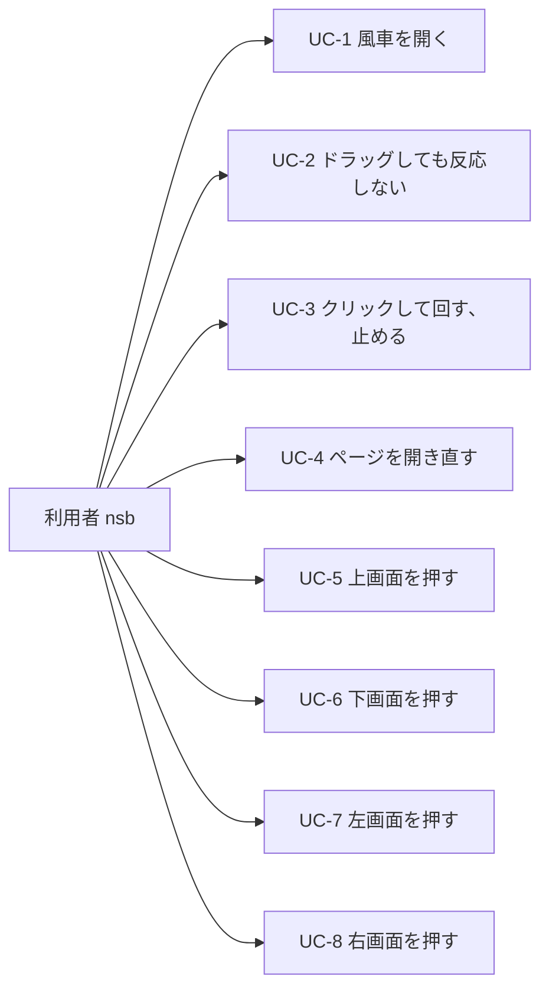
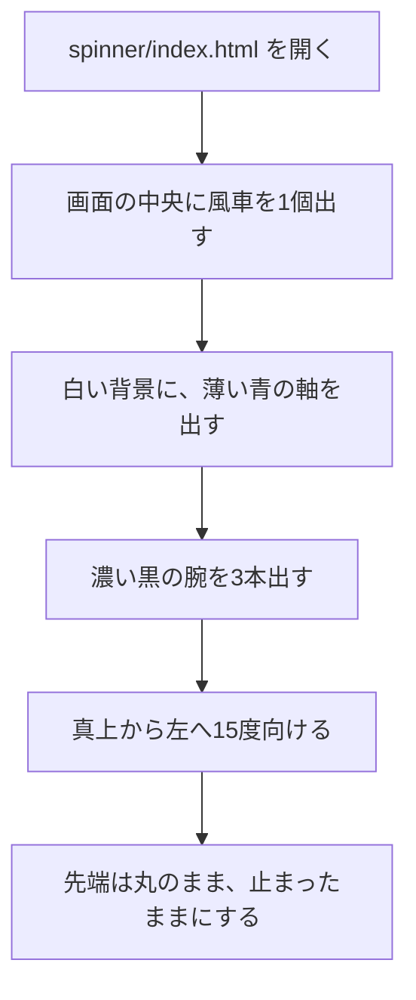
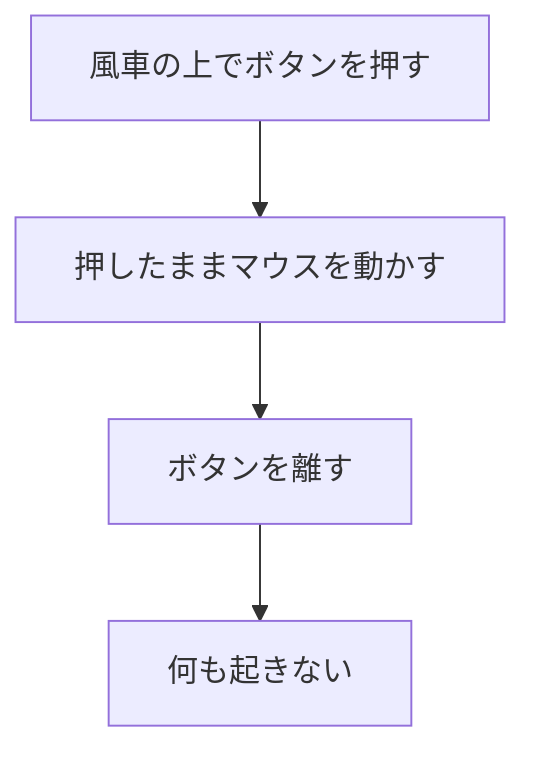
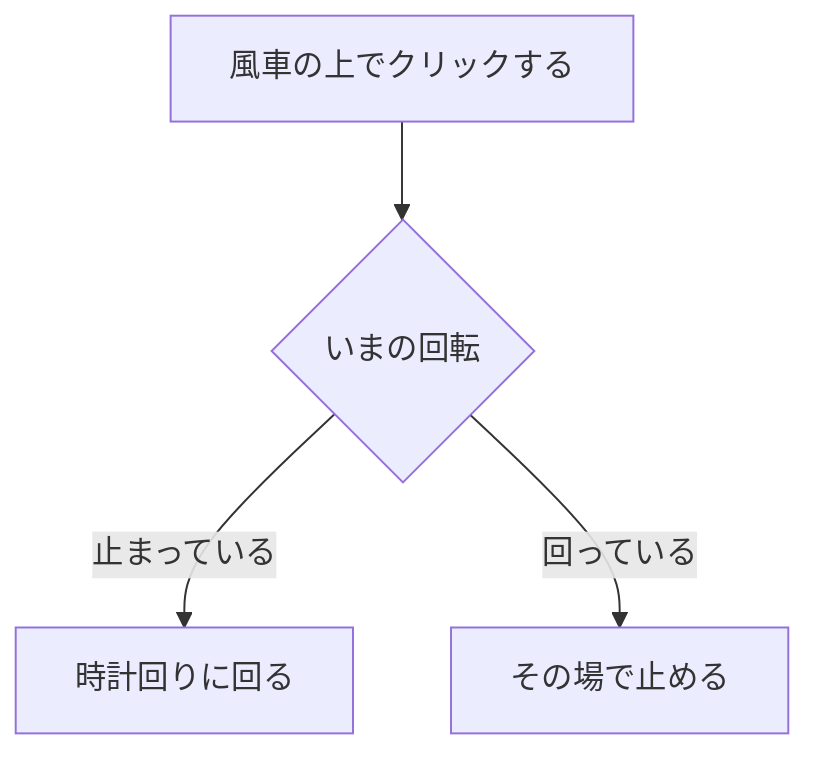
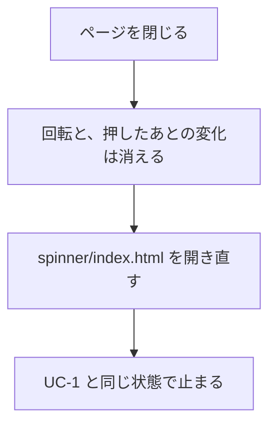
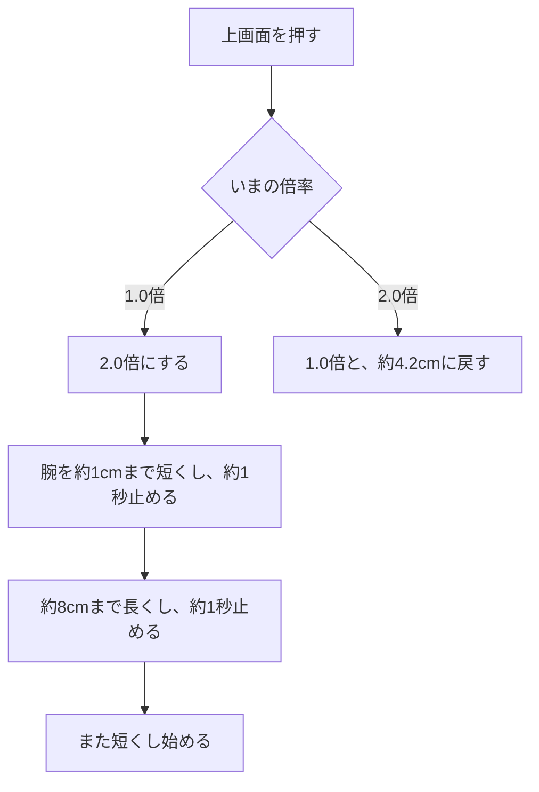
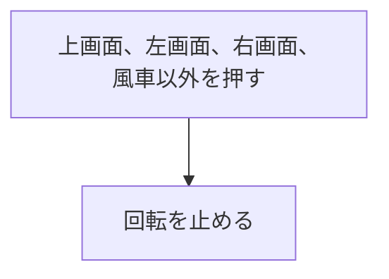
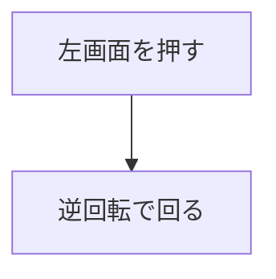
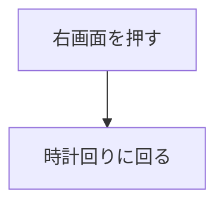

# ユースケース

| 項目 | 内容 |
|---|---|
| 文書名 | ユースケース |
| 対象システム | 風車 |
| 版 | 2.3 |
| 作成日 | 2026年10月11日 |
| 作成者 | nsb |
| 関連資料 | 要件定義書、用語定義書、機能要件、画面見取り図、ER図、`spinner/index.html` |
| 目的 | 利用者が達成することを、流れで示す |

この資料は、利用の流れです。言葉の意味は「用語定義書」に従います。番号の正は「要件定義書」の「この版で作ること」です。関係の図は「ER図」です。

新しい操作は、この資料では足しません。画面は1枚です。ファイルは `spinner/index.html` です。

---

## 1. アクター

| アクター | 役割 |
|---|---|
| 利用者 | nsb 一人。風車を開き、クリックして回す |
| 提出先 | 資料の読み手。アプリの利用者ではない。この図には入れない |

---

## 2. ユースケース図

---

## 3. UC-1 風車を開く

| 項目 | 内容 |
|---|---|
| アクター | 利用者 |
| 対応する機能 | H-1、H-4 |
| 事前条件 | 自分のパソコンに、`spinner/index.html` がある |
| 事後条件 | 風車が1個、画面の中央に止まって見える |

軸は丸で、中心に穴があります。腕は太く、太さは根元と同じ約4.1cmです。根元は両隣の根元とつながります。開いたときの先端は丸で、太さも約4.1cmです。軸の周りに等しい間隔です。通常の長さは約4.2cmです。向きは、真上から左へ15度です。

---

## 4. UC-2 ドラッグしても反応しない

| 項目 | 内容 |
|---|---|
| アクター | 利用者 |
| 対応する機能 | H-3 |
| 事前条件 | UC-1 のあと、画面が開いている |
| 事後条件 | 回転も、腕の長さも、先端も、変わらない |

---

## 5. UC-3 クリックして回す、止める

| 項目 | 内容 |
|---|---|
| アクター | 利用者 |
| 対応する機能 | H-2 |
| 事前条件 | 画面が開いている |
| 事後条件 | 止まっていれば時計回りに回る。回っていれば、その場で止まる。この状態は保存しない |

---

## 6. UC-4 ページを開き直す

| 項目 | 内容 |
|---|---|
| アクター | 利用者 |
| 対応する機能 | H-1、H-4、H-5、H-6 |
| 事前条件 | 一度、画面を開いている |
| 事後条件 | 回転と倍率は残らない。先端は丸、長さは約4.2cm、倍率は1.0倍。UC-1 の状態に戻る |

---

## 7. UC-5 上画面を押す

| 項目 | 内容 |
|---|---|
| アクター | 利用者 |
| 対応する機能 | H-5 |
| 事前条件 | 画面が開いている。開いた直後の先端は丸 |
| 事後条件 | 動きは2.0倍になる。腕の長さは約1cmと約8cmのあいだで変わる。もう一度押すと、1.0倍に戻り、長さは約4.2cmに戻る。先端は丸のまま。回転は止まらず、回り続ける |

---

## 8. UC-6 下画面を押す

| 項目 | 内容 |
|---|---|
| アクター | 利用者 |
| 対応する機能 | H-6 |
| 事前条件 | 画面が開いている。下画面は画面全体。上画面、左画面、右画面は、この中に含まれる |
| 事後条件 | 上画面、左画面、右画面、風車以外を押すと、回転が、その場で止まる |

---

## 9. UC-7 左画面を押す

| 項目 | 内容 |
|---|---|
| アクター | 利用者 |
| 対応する機能 | H-7 |
| 事前条件 | 画面が開いている。左画面は、風車の上端より下で、左端より左。印は↺ |
| 事後条件 | 逆回転で回る。回転は止まらず、回り続ける |

---

## 10. UC-8 右画面を押す

| 項目 | 内容 |
|---|---|
| アクター | 利用者 |
| 対応する機能 | H-8 |
| 事前条件 | 画面が開いている。右画面は、風車の上端より下で、右端より右。印は↻ |
| 事後条件 | 時計回りに回る。回転は止まらず、回り続ける |

---

## 11. この資料に入れないこと

要件定義書で作らないとしたものです。ユースケースにはしません。

- 風車以外の物を回す
- 点数やゲーム
- ログイン
- 他の人との共有
- インターネットへの公開
- サーバとデータベースへの保存
- 有料のサービスを使う
- 左右の倍速ボタン
- 0.5倍速
- 先端を四角にすること
- 2.5倍

重なった場所は、UC-5、UC-7、UC-8 に入れました。上画面を押しても、回転は止まりません。変わるのは、倍率だけです。左画面を押すと逆回転、右画面を押すと時計回りで、回り続けます。

---

## 12. 改訂履歴

| 版 | 日付 | 内容 |
|---|---|---|
| 1.0 | 2026年10月11日 | 初版。開く、ドラッグして回す、クリックする、開き直す流れを書いた |
| 1.1 | 2026年10月11日 | 上、下、左、右を押す流れを加えた。背景、角度、色の濃さを UC-1 に合わせた |
| 1.2 | 2026年10月11日 | 上画面の境目、倍率1.0倍、上下の幅約10cmと一往復30秒を流れに合わせた |
| 1.3 | 2026年10月11日 | 下画面を画面全体、左右を端として流れに合わせた |
| 1.4 | 2026年10月11日 | 左と右の操作を、真ん中から端までの倍速ボタンに変えた |
| 1.5 | 2026年10月13日 | クリックで回すこと、ドラッグは反応しないこと、腕の形、下画面で回転が止まること、0.5倍と2.5倍を、要件定義書 2.6 に合わせた |
| 1.6 | 2026年10月16日 | 重なった場所では両方の変化を同時に行うことを、要件定義書 2.7 に合わせ、UC-5、UC-7、UC-8 に入れた |
| 1.7 | 2026年10月16日 | 重なった場所の訂正を、要件定義書 2.8 に合わせた。上画面や倍速ボタンを押しても、回転は回り続ける |
| 1.8 | 2026年10月16日 | 上画面を2.0倍に変え、左右の倍速ボタンと0.5倍を廃止したことを、要件定義書 2.9 に合わせた |
| 1.9 | 2026年10月16日 | 左画面の↺と逆回転、右画面の↻と時計回りを、要件定義書 3.0 に合わせた |
| 2.0 | 2026年10月16日 | 2.0倍のあいだ腕の長さが変わることを、要件定義書 3.1 に合わせ、UC-5 に入れた |
| 2.1 | 2026年10月16日 | ハンドスピナーのクリックで回り、回っていれば止まることを、要件定義書 3.2 に合わせた |
| 2.2 | 2026年10月16日 | 言葉の意味の正を、用語定義書にした |
| 2.3 | 2026年10月18日 | 呼び方を風車にした。要件定義書 4.2 に合わせた |
