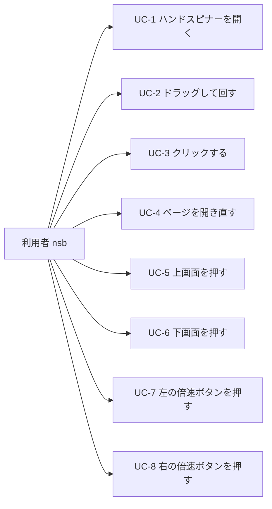
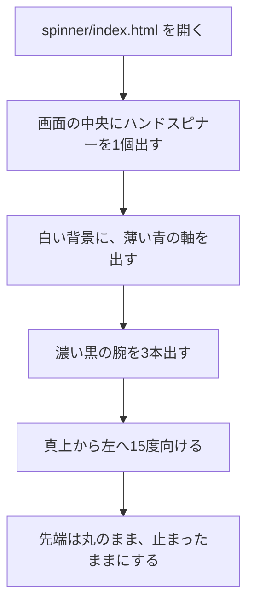
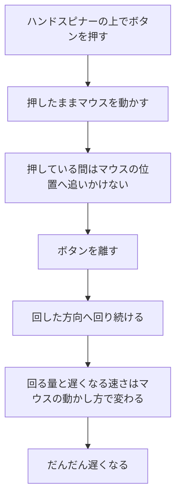
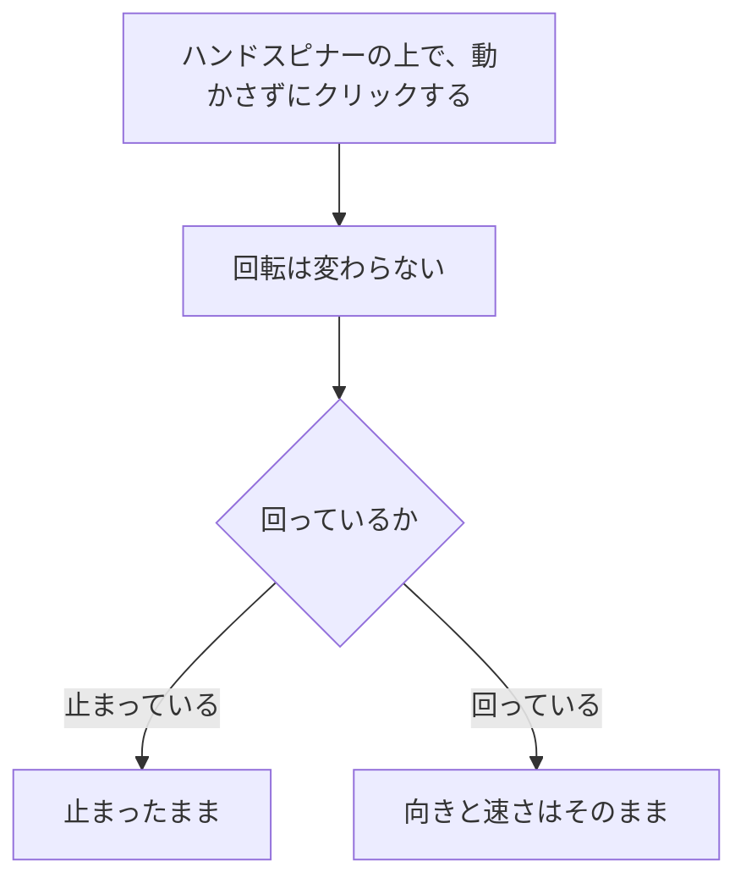
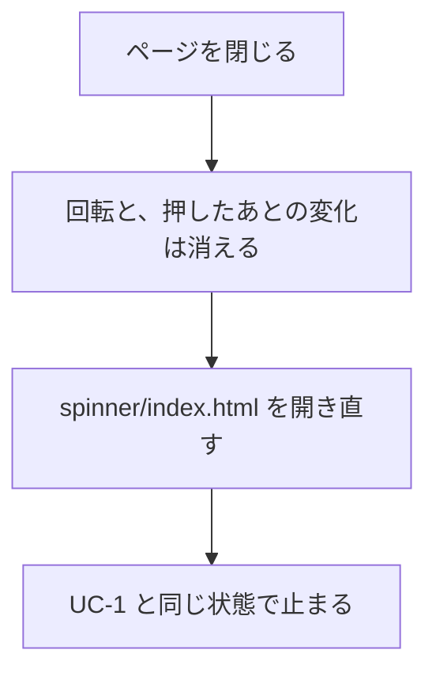
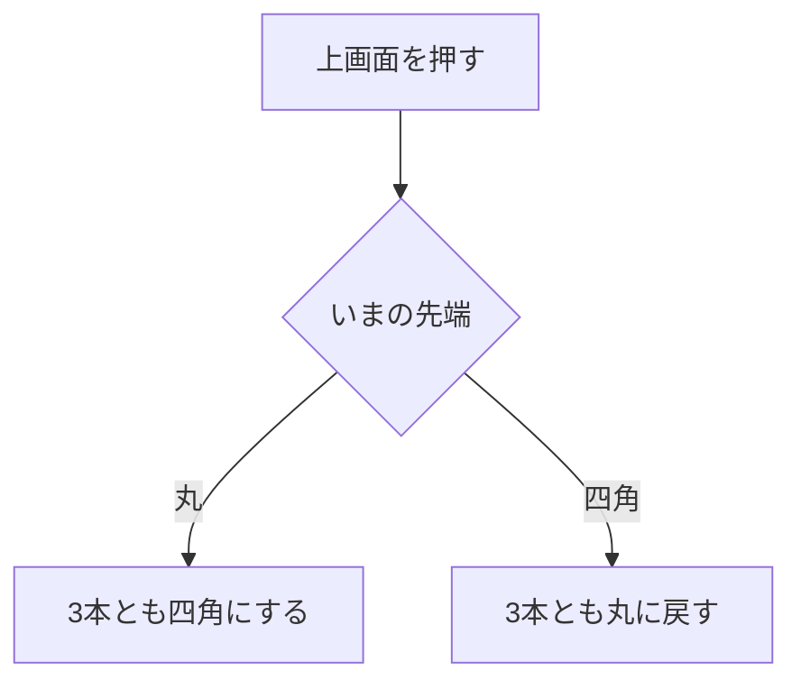
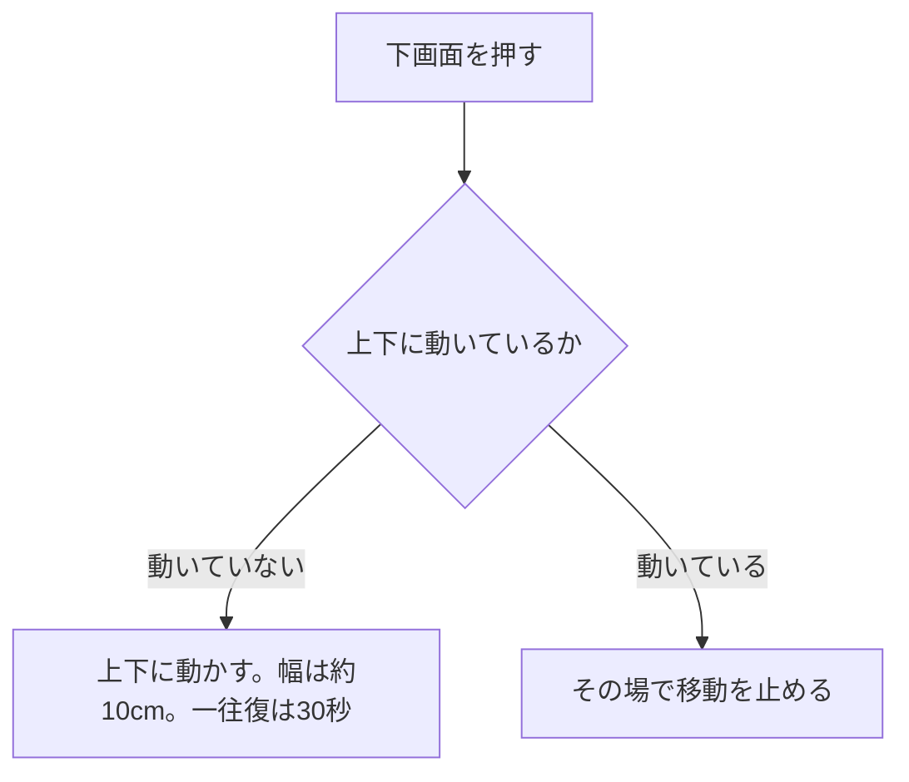
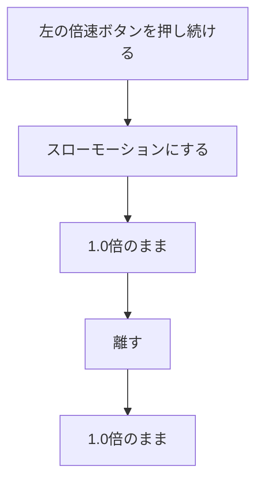
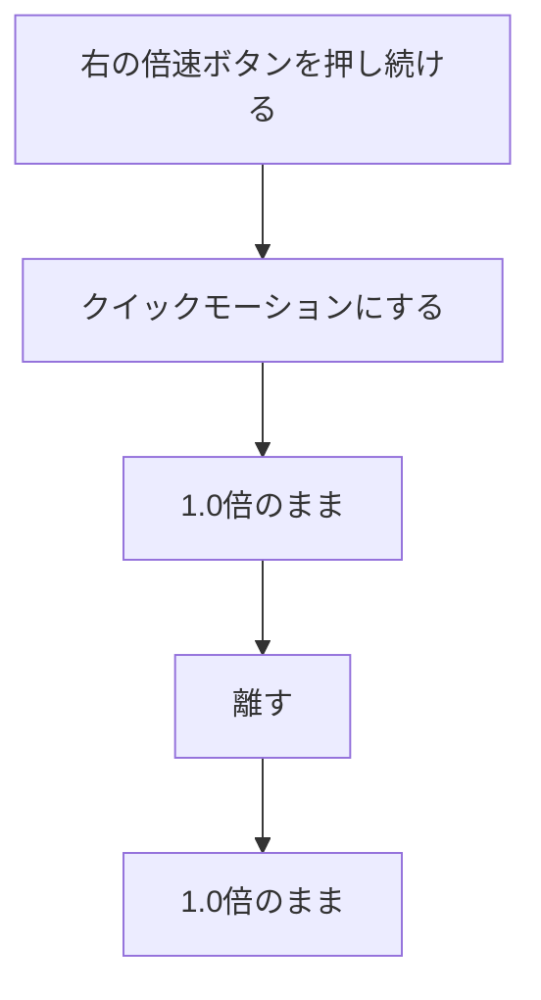

# ユースケース

| 項目 | 内容 |
|---|---|
| 文書名 | ユースケース |
| 対象システム | ハンドスピナー |
| 版 | 1.4 |
| 作成日 | 2026年10月11日 |
| 作成者 | nsb |
| 関連資料 | 要件定義書、機能要件、画面見取り図、ER図、`spinner/index.html` |
| 目的 | 利用者が達成することを、流れで示す |

この資料は、利用の流れです。言葉の意味は「要件定義書」の言葉の表に従います。番号の正は「要件定義書」の「この版で作ること」です。関係の図は「ER図」です。

新しい操作は、この資料では足しません。画面は1枚です。ファイルは `spinner/index.html` です。

---

## 1. アクター

| アクター | 役割 |
|---|---|
| 利用者 | nsb 一人。ハンドスピナーを開き、ドラッグして回す |
| 提出先 | 資料の読み手。アプリの利用者ではない。この図には入れない |

---

## 2. ユースケース図

---

## 3. UC-1 ハンドスピナーを開く

| 項目 | 内容 |
|---|---|
| アクター | 利用者 |
| 対応する機能 | H-1、H-4 |
| 事前条件 | 自分のパソコンに、`spinner/index.html` がある |
| 事後条件 | ハンドスピナーが1個、画面の中央に止まって見える |

軸は丸で、中心に穴があります。腕は細く、開いたときの先端は丸で、軸の周りに等しい間隔です。軸の中心から先端まで約15cmです。向きは、真上から左へ15度です。

---

## 4. UC-2 ドラッグして回す

| 項目 | 内容 |
|---|---|
| アクター | 利用者 |
| 対応する機能 | H-3 |
| 事前条件 | UC-1 のあと、画面が開いている |
| 事後条件 | 離した方向へ回っている。そのあと、だんだん遅くなる。この状態は保存しない |

---

## 5. UC-3 クリックする

| 項目 | 内容 |
|---|---|
| アクター | 利用者 |
| 対応する機能 | H-2 |
| 事前条件 | 画面が開いている |
| 事後条件 | ハンドスピナーの上でのクリックの前と、回転の向きも速さも同じである |

---

## 6. UC-4 ページを開き直す

| 項目 | 内容 |
|---|---|
| アクター | 利用者 |
| 対応する機能 | H-1、H-4、H-5、H-6、H-7、H-8 |
| 事前条件 | 一度、画面を開いている |
| 事後条件 | 回転、四角の先端、上下の位置、倍率は残らない。UC-1 の状態に戻る |

---

## 7. UC-5 上画面を押す

| 項目 | 内容 |
|---|---|
| アクター | 利用者 |
| 対応する機能 | H-5 |
| 事前条件 | 画面が開いている。開いた直後の先端は丸 |
| 事後条件 | 3本の先端が、押す前と逆の形になる。丸なら四角、四角なら丸 |

---

## 8. UC-6 下画面を押す

| 項目 | 内容 |
|---|---|
| アクター | 利用者 |
| 対応する機能 | H-6 |
| 事前条件 | 画面が開いている。下画面は画面全体 |
| 事後条件 | 動いていなければ、上下に動き始める。幅は約10cm。一往復は30秒。動いていれば、その場で止まる |

---

## 9. UC-7 左の倍速ボタンを押す

| 項目 | 内容 |
|---|---|
| アクター | 利用者 |
| 対応する機能 | H-7 |
| 事前条件 | 画面が開いている。左の倍速ボタンは、真ん中から左端まである |
| 事後条件 | 押しているあいだも、離したあとも、動きは1.0倍である |

---

## 10. UC-8 右の倍速ボタンを押す

| 項目 | 内容 |
|---|---|
| アクター | 利用者 |
| 対応する機能 | H-8 |
| 事前条件 | 画面が開いている。右の倍速ボタンは、真ん中から右端まである |
| 事後条件 | 押しているあいだも、離したあとも、動きは1.0倍である |

---

## 11. この資料に入れないこと

要件定義書で作らないとしたものです。ユースケースにはしません。

- 風車や、ハンドスピナー以外の物を回す
- 点数やゲーム
- ログイン
- 他の人との共有
- インターネットへの公開
- サーバとデータベースへの保存
- 有料のサービスを使う

次は、まだ決めていないので、流れに入れません。

| 項目 | いまの状態 |
|---|---|
| 重なった場所 | 下画面は画面全体なので、上画面や倍速ボタンの場所も下画面に含まれる。同時に変化するか、一方だけかは決めていない |

---

## 12. 改訂履歴

| 版 | 日付 | 内容 |
|---|---|---|
| 1.0 | 2026年10月11日 | 初版。開く、ドラッグして回す、クリックする、開き直す流れを書いた |
| 1.1 | 2026年10月11日 | 上、下、左、右を押す流れを加えた。背景、角度、色の濃さを UC-1 に合わせた |
| 1.2 | 2026年10月11日 | 上画面の境目、倍率1.0倍、上下の幅約10cmと一往復30秒を流れに合わせた |
| 1.3 | 2026年10月11日 | 下画面を画面全体、左右を端として流れに合わせた |
| 1.4 | 2026年10月11日 | 左と右の操作を、真ん中から端までの倍速ボタンに変えた |
