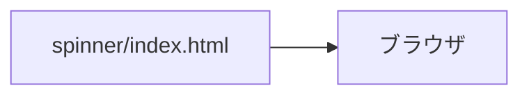

# 技術スタック

| 項目 | 内容 |
|---|---|
| 文書名 | 技術スタック |
| 対象システム | ハンドスピナー |
| 版 | 1.6 |
| 作成日 | 2026年10月11日 |
| 作成者 | nsb |
| 関連資料 | 要件定義書、用語定義書、機能要件、データベース設計、画面見取り図、`spinner/index.html` |
| 目的 | 採用する技術と、採用しない技術を決める |

何を作るかは「要件定義書」と「機能要件」を正とします。表の項目は「データベース設計」を正とします。  
言葉の意味は「用語定義書」に従います。配置の図は「画面見取り図」です。

この資料は、ブラウザだけでページを開くための選定です。選択ボードで使った、Python、FastAPI、Uvicorn、Jinja2、SQLite、pip、venv は使いません。

費用は 0 円です。追加のソフトも、有料のサービスも入れません。

---

## 1. 全体の組み合わせ

画面は、`spinner/index.html` をブラウザで開きます。サーバは置きません。保存のファイルも置きません。

| 層 | 採用するもの | 役割 |
|---|---|---|
| 画面の骨組み | HTML | 軸と腕を、ページの部品として置く |
| 見た目 | CSS | 色、形、中央への配置を書く。HTML と同じファイルに書く |
| 動き | JavaScript | クリックで回す、クリックで止める、上画面で2.0倍にする、腕の長さの変化、左画面で逆回転、右画面で時計回り、回転を止める、を書く |
| 保存 | なし | 表は論理的な約束だけ。ファイルには書かない |
| サーバ | なし | ページの要求を受けるプログラムは置かない |

いまの実装の進みは、次のとおりです。

| 場所 | いまの状態 |
|---|---|
| `spinner/index.html` | HTML、CSS、JavaScript がある。軸、つながった腕3本、先端、左の↺、右の↻がある |
| JavaScript | 同じ HTML の中にある。クリックで回す、クリックで止める、ドラッグは反応しない、上画面で2.0倍にする、腕の長さの変化、左画面で逆回転、右画面で時計回り、回転を止める、を書く |

---

## 2. 採用した版

パッケージは入れないので、ライブラリの版はありません。

| 技術 | 版 | 置き場所 |
|---|---|---|
| HTML | ブラウザが読む、ページの書き方 | `spinner/index.html` |
| CSS | ブラウザが読む、見た目の書き方 | 同上。`<style>` の中 |
| JavaScript | ブラウザに入っている言語 | 同じ HTML の中。`<script>` の中 |

ブラウザは、自分のパソコンに入っているものを使います。新しいブラウザの購入はしません。

---

## 3. 起動

手元のパソコンで動かします。ログインは不要です。インターネット上には出しません。仮想環境も、サーバの起動も要りません。

1. `spinner` フォルダを開く
2. `index.html` をダブルクリックする
3. ブラウザに、ハンドスピナーのページが出る

止めるときは、そのブラウザのタブを閉じます。

---

## 4. 採用するもの

| 採用するもの | 層 | 理由 |
|---|---|---|
| HTML | 画面 | サーバに組み立てさせず、ファイルをそのまま開く |
| CSS | 見た目 | 軸の丸、腕の色、中央への配置を書く。見た目用の別ライブラリは入れない |
| JavaScript | 動き | 回す、クリックで止める、上画面で2.0倍にする、腕の長さの変化、逆回転、時計回り、回転を止める、はブラウザの中で足りる |
| ダブルクリックで開く | 起動 | ポート番号も、起動コマンドも要らない |

---

## 5. 採用しないもの

選択ボードで採用したものは、この版では使いません。

| 採用しないもの | 理由 |
|---|---|
| Python | 選択ボードの言語。今回の動きは JavaScript |
| FastAPI | 選択ボードのサーバ。今回はサーバを作らない |
| Uvicorn | 選択ボードの起動。今回は `index.html` を開く |
| Jinja2 | 選択ボードの HTML の組み立て。今回は HTML ファイルをそのまま開く |
| SQLite | 選択ボードの保存。今回はファイルに書かない |
| sqlite3 | 選択ボードの SQL。今回は SQL を書かない |
| pip と venv | 選択ボードのパッケージ。今回は追加のパッケージを入れない |
| 有料のサービス | 課題提出用であり、費用をかけない |

---

## 6. 改訂履歴

| 版 | 日付 | 内容 |
|---|---|---|
| 1.0 | 2026年10月11日 | 初版。HTML、CSS、JavaScript を採用した。選択ボードの Python と FastAPI と SQLite は採用しない |
| 1.1 | 2026年10月13日 | JavaScript を、同じ HTML の中に置いた。クリックで回す、倍速、腕の長さの変化を、このファイルで行う |
| 1.2 | 2026年10月16日 | 上画面の2.0倍と、倍速ボタンの廃止を、要件定義書 2.9 に合わせた |
| 1.3 | 2026年10月16日 | 左の↺と逆回転、右の↻と時計回りを、要件定義書 3.0 に合わせた |
| 1.4 | 2026年10月16日 | 2.0倍のあいだの腕の長さの変化を、要件定義書 3.1 に合わせた |
| 1.5 | 2026年10月16日 | ハンドスピナーのクリックで回り、回っていれば止まることを、要件定義書 3.2 に合わせた |
| 1.6 | 2026年10月16日 | 言葉の意味の正を、用語定義書にした |
