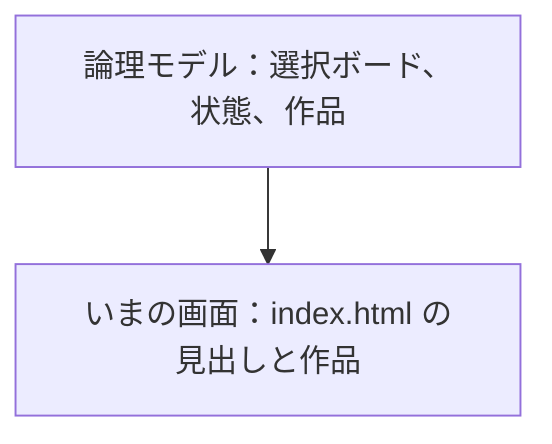
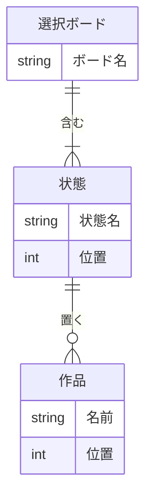
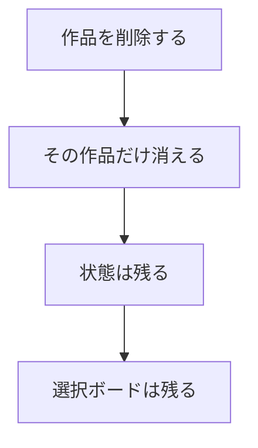

# ER図

| 項目 | 内容 |
|---|---|
| 文書名 | ER図 |
| 対象システム | 選択ボード |
| 版 | 1.1 |
| 作成日 | 2026年10月9日 |
| 作成者 | nsb |
| 関連資料 | 用語定義書、要件定義書、機能要件、機能要件定義書、データベース設計 |
| 目的 | 選択ボード、状態、作品の関係を図で示す |

この資料は、関係の図です。言葉の意味は「用語定義書」に従います。  
表の項目と約束の正は「データベース設計」です。使うデータベース製品と、この版で表に残すかは、まだ決めていません。

---

## 1. この図の位置づけ

| 種類 | 内容 |
|---|---|
| この ER 図 | 選択ボード、状態、作品の論理的な関係 |
| いまの画面 | `index.html` の見出しと作品。ページを閉じると、見本の並びに戻る |
| データベース設計 | 表の項目と約束。関係の図は、この資料 |
| 保存 | この版では約束しない。作らないとは決めていない |

---

## 2. 論理 ER 図

選択ボードは1件です。その中に状態が3つあり、各状態の中に作品が0件以上あります。

---

## 3. エンティティ

| エンティティ | 意味 | 画面上の呼び方 |
|---|---|---|
| 選択ボード | 状態と作品をまとめて置く台。今回は常に1件 | 画面全体 |
| 状態 | 作品を入れる縦の列。今回は「見たい」「途中」「見た」の3つ | 列 |
| 作品 | 状態の中に置く、映画1本ぶんの枠 | 作品 |

---

## 4. リレーション

| 関係 | 多重度 | 説明 |
|---|---|---|
| 選択ボードと状態 | 1 対 3 | 選択ボード1件に、状態はちょうど3つ。状態は必ずこの選択ボードに属する。状態の追加と削除はしない |
| 状態と作品 | 1 対 0以上 | 状態1つに、作品は0件以上。作品は必ず1つの状態に属する |
| 作品の移動 | 所属と位置の付け替え | 作品をつまんで置くと、属する状態と、その中の位置が変わる。作品は増えない（機能要件 W-5） |

状態の位置は、左から「見たい」「途中」「見た」で固定です。作品の位置は、その状態の中の並びです。追加した作品は、その状態の末尾に足します（機能要件 W-2）。

---

## 5. 属性

| 論理項目 | いまの画面 | 備考 |
|---|---|---|
| 選択ボード.ボード名 | 左上の大きい文字 | 初期値は「映画鑑賞」。書き換えない（機能要件 B-2） |
| 状態.状態名 | 各列の上部 | 「見たい」「途中」「見た」。書き換えない（機能要件 S-1） |
| 状態.位置 | 列の左からの並び | 専用の値は持たない。画面に並んでいる順 |
| 作品.名前 | 作品の名前 | 前後の空白は除く。空では追加しない。空の編集は元の名前のまま（機能要件 W-2、W-3） |
| 作品.位置 | その状態の中の並び | 専用の値は持たない。画面に並んでいる順 |

作品の名前は、同じ名前を禁じていません。いまの画面では、作品は画面上の枠そのもので、名前とは別の識別子は持っていません。

---

## 6. 削除時の関係

作品を消しても、状態と選択ボードは残ります（機能要件 W-4）。  
状態と選択ボードは、この版では消しません（機能要件 B-1、S-1）。

---

## 7. 改訂履歴

| 版 | 日付 | 内容 |
|---|---|---|
| 1.0 | 2026年10月9日 | 初版。選択ボード、状態、作品の関係を書いた。保存の形は入れていない |
| 1.1 | 2026年10月9日 | 表の項目と約束の正を、データベース設計にした |
