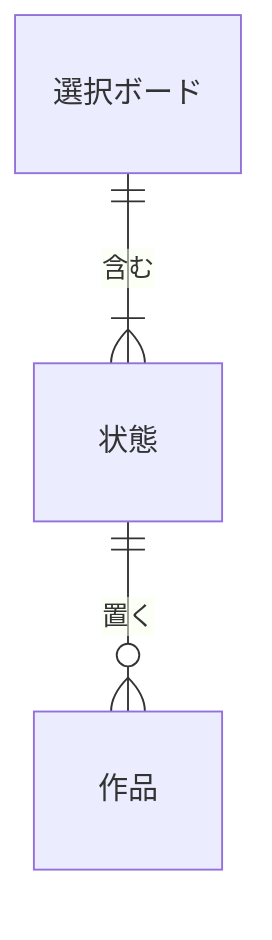

# データベース設計

| 項目 | 内容 |
|---|---|
| 文書名 | データベース設計 |
| 対象システム | 選択ボード |
| 版 | 1.2 |
| 作成日 | 2026年10月9日 |
| 作成者 | nsb |
| 関連資料 | 用語定義書、要件定義書、機能要件、ER図、非機能要件、技術スタック |
| 目的 | 選択ボード、状態、作品を表にしたときの項目と約束を決める |

関係の図は「ER図」を正とします。言葉の意味は「用語定義書」に従います。  
使うデータベース製品は SQLite です。詳細は「技術スタック」を正とします。  
フォルダ直下の `index.html` は、まだこの表へ書きません。ページを閉じると、見本の並びに戻ります。

この資料での呼び方は、次のとおりです。

| 呼び方 | 意味 |
|---|---|
| 表 | 同じ種類の行を並べたもの |
| 主キー | その表の中で、1行を区別する項目 |
| 外部キー | 親の表の行を指す項目 |

---

## 1. 表の一覧

| 表 | 主キー | 外部キー | 行数 |
|---|---|---|---|
| 選択ボード | 識別子 | なし | この版では1行 |
| 状態 | 識別子 | 選択ボードの識別子 | この版では3行 |
| 作品 | 識別子 | 状態の識別子 | 0行以上 |

識別子は、SQLite の整数です。`server/schema.sql` が、見本の行に 1 から番号を付けます。作品の名前は主キーにしません。同じ名前を許すためです。

---

## 2. 選択ボード

| 項目 | 型 | 必須 | 約束 |
|---|---|---|---|
| 識別子 | 識別子 | 必須 | 主キー。この表の中で重複しない |
| ボード名 | 文字列 | 必須 | この版では「映画鑑賞」。書き換えない |

---

## 3. 状態

| 項目 | 型 | 必須 | 約束 |
|---|---|---|---|
| 識別子 | 識別子 | 必須 | 主キー。この表の中で重複しない |
| 選択ボードの識別子 | 識別子 | 必須 | 外部キー。親は選択ボードの1行 |
| 状態名 | 文字列 | 必須 | 「見たい」「途中」「見た」のいずれか。同じ選択ボードの中で重複しない。書き換えない |
| 位置 | 整数 | 必須 | 左からの順番。この版では 1、2、3。同じ選択ボードの中で重複しない |

状態の追加と削除はしません。位置の付け替えもしません。

---

## 4. 作品

| 項目 | 型 | 必須 | 約束 |
|---|---|---|---|
| 識別子 | 識別子 | 必須 | 主キー。この表の中で重複しない。名前を変えても、識別子は変えない |
| 状態の識別子 | 識別子 | 必須 | 外部キー。親は状態の1行。作品は必ず1つの状態に属する |
| 名前 | 文字列 | 必須 | 前後の空白は除く。除いたあとが空の行は作らない。同じ名前は許す |
| 位置 | 整数 | 必須 | その状態の中の順番。同じ状態の中で重複しない。小さいほど上 |

文字数の上限は、まだ決めません。

追加した作品は、その状態の中で、いちばん大きい位置より大きい位置を1つ付けます。末尾に足すためです。

---

## 5. 初期データ

画面を開いたときの見本は、次の行です。

| 表 | 内容 |
|---|---|
| 選択ボード | ボード名「映画鑑賞」が1行 |
| 状態 | 位置1「見たい」、位置2「途中」、位置3「見た」 |
| 作品 | 見たいの位置1「君の名は。」、位置2「インターステラー」。途中の位置1「三体」。見たの位置1「ショーシャンクの空に」 |

---

## 6. 移動と削除

移動は、作品の行を増やしません。状態の識別子と位置を付け替えます（機能要件 W-5）。

削除は、その作品の行だけを消します。状態と選択ボードは残します（機能要件 W-4）。残った作品の前後関係は維持します。空いた位置の番号を詰め直すことは、この資料では約束しません。

---

## 7. いまの画面との対応

| 論理項目 | いまの `index.html` |
|---|---|
| 選択ボード.ボード名 | 左上の大きい文字 |
| 状態.状態名 | 各列の上部 |
| 状態.位置 | 列の左からの並び。専用の値は持たない |
| 作品.名前 | 作品の名前 |
| 作品.位置 | その状態の中の並び。専用の値は持たない |
| 各表の識別子 | 持たない。作品は画面上の枠そのもの |

いまの `index.html` は、この表へ書きません。ページを閉じると、上の見本に戻ります。  
`server/` は起動時に、SQLite のファイル `server/data/board.sqlite` へ表と見本の行を作ります。`http://127.0.0.1:8000/` の追加、編集、削除、移動は、このファイルへ書きます。削除したあとは、残った作品の位置を 1 から振り直します。

---

## 8. 改訂履歴

| 版 | 日付 | 内容 |
|---|---|---|
| 1.0 | 2026年10月9日 | 初版。選択ボード、状態、作品の項目と約束を書いた。データベース製品と、この版で残すかは入れていない |
| 1.1 | 2026年10月9日 | 製品を SQLite とし、識別子を整数にした。画面の操作を表へ書くのは、まだこの段階ではしない |
| 1.2 | 2026年10月9日 | サーバの画面の追加、編集、削除、移動を表へ書くようにした。削除後の位置は 1 から振り直す |
