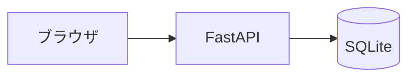

# 技術スタック

| 項目 | 内容 |
|---|---|
| 文書名 | 技術スタック |
| 対象システム | 選択ボード |
| 版 | 1.1 |
| 作成日 | 2026年10月9日 |
| 作成者 | nsb |
| 関連資料 | 用語定義書、要件定義書、データベース設計、画面設計書、操作手順書 |
| 目的 | 採用する技術と、採用しない技術を決める |

何を作るかは「要件定義書」と「機能要件」を正とします。表の項目は「データベース設計」を正とします。  
言葉の意味は「用語定義書」に従います。

この資料は、画面をサーバで組み立て、保存に SQLite を使うための選定です。

---

## 1. 全体の組み合わせ

画面は、Python のサーバが HTML を返します。保存は、手元の SQLite ファイル 1つです。ブラウザ用の別フレームワークは使いません。



| 層 | 採用するもの | 役割 |
|---|---|---|
| 画面 | FastAPI と Jinja2 | サーバが HTML を組み立てて返す |
| サーバ | FastAPI（Python） | 画面の要求を受け、SQLite を読む |
| 保存 | SQLite | 選択ボード、状態、作品を表で持つ |
| 言語 | Python | サーバも、SQL の呼び出しも Python |
| パッケージ | pip と venv | 依存関係の導入 |

いまの実装の進みは、次のとおりです。

| 場所 | いまの状態 |
|---|---|
| フォルダ直下の `index.html` など | 認識合わせ用のプロトタイプ。ページを閉じると見本に戻る |
| `server/` | FastAPI。起動時に SQLite の表と見本の行を作る。追加、編集、削除、移動を表へ書く |
| `server/data/board.sqlite` | 起動するとできる SQLite ファイル。リポジトリには入れない |

---

## 2. 採用した版

| 技術 | 版 | 置き場所 |
|---|---|---|
| Python | 3.12.10 | パソコンの Python。仮想環境は `server/.venv` |
| FastAPI | 0.143.0 | `server/requirements.txt` |
| Uvicorn | 0.54.0 | 同上。サーバの起動に使う |
| Jinja2 | 3.1.6 | 同上。HTML の組み立てに使う |
| SQLite | 3.49.1 | Python 3.12.10 に同梱。ファイルは `server/data/board.sqlite` |

---

## 3. 起動

手元のパソコンで動かします。ログインは不要です。インターネット上には出しません。

1. `server` フォルダを開く
2. 仮想環境が無いときは、次で作る

```powershell
& "$env:LocalAppData\Programs\Python\Python312\python.exe" -m venv .venv
.\.venv\Scripts\python.exe -m pip install -r requirements.txt
```

3. サーバを起動する

```powershell
.\.venv\Scripts\python.exe -m uvicorn app:app --host 127.0.0.1 --port 8000
```

4. ブラウザで `http://127.0.0.1:8000/` を開く。作品の追加、編集、削除、つまんで移動ができる。ページを開き直しても、その結果は残る
5. `http://127.0.0.1:8000/health` が `{"status":"ok","database":"up"}` を返せば、データベースへ接続できている

止めるときは、起動した PowerShell で `Ctrl+C` を押します。

フォルダ直下の `index.html` は、これまでどおりダブルクリックで開きます。このサーバとは別です。

---

## 4. 採用するもの

| 採用するもの | 層 | 理由 |
|---|---|---|
| Python 3.12.10 | サーバ | 画面の組み立てと、SQLite への SQL を同じ言語で書く |
| FastAPI 0.143.0 | サーバ | URL ごとに処理を分ける。起動確認と、見本の表示に使う |
| Uvicorn 0.54.0 | サーバ | FastAPI を手元の 8000 番で動かす |
| Jinja2 3.1.6 | 画面 | HTML のひな形に、表から読んだ名前を入れる。作品の名前は文字として出す |
| SQLite | 保存 | ファイル 1つで表を残す。別のデータベース用ソフトは入れない |
| sqlite3 | 保存 | Python に同梱の機能で SQL を実行する |
| CSS | 画面 | 見た目。追加の見た目用ライブラリは使わない |

識別子は、SQLite の整数です。表が空のときに、`server/schema.sql` が見本の行へ 1 から番号を付けます。

---

## 5. 採用しないもの

| 採用しないもの | 理由 |
|---|---|
| React | 前回の課題管理ボードの画面。今回はサーバが HTML を返す |
| Vite | 前回の画面の開発サーバ。今回は Uvicorn で足りる |
| Java | 前回の API の言語。今回は Python |
| Spring Boot | 前回の API。今回は FastAPI |
| Maven | 前回のビルド。今回は pip と venv |
| PostgreSQL | 前回の保存。今回は SQLite |
| JDBC | 前回の SQL の呼び出し方。今回は Python の sqlite3 |
| Docker | 前回はデータベースの起動に使った。今回はファイル 1つで足りる |
| ORM | SQL の形が見えにくくなる。SQL をそのまま書く |
| ブラウザ側の画面フレームワーク | 画面はサーバが返す HTML で足りる |

---

## 6. 改訂履歴

| 版 | 日付 | 内容 |
|---|---|---|
| 1.0 | 2026年10月9日 | 初版。FastAPI、Jinja2、SQLite を採用した。起動確認と、見本の表示まで |
| 1.1 | 2026年10月9日 | サーバの画面で、作品の追加、編集、削除、移動を SQLite に残すようにした |
