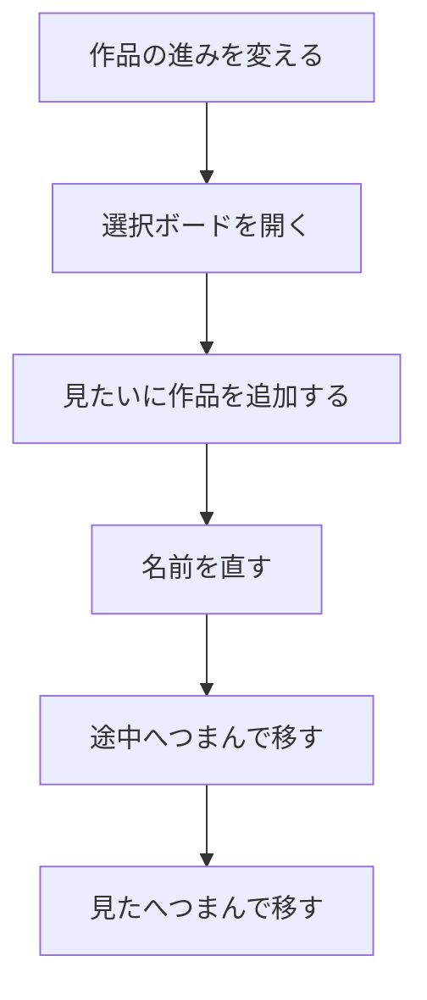
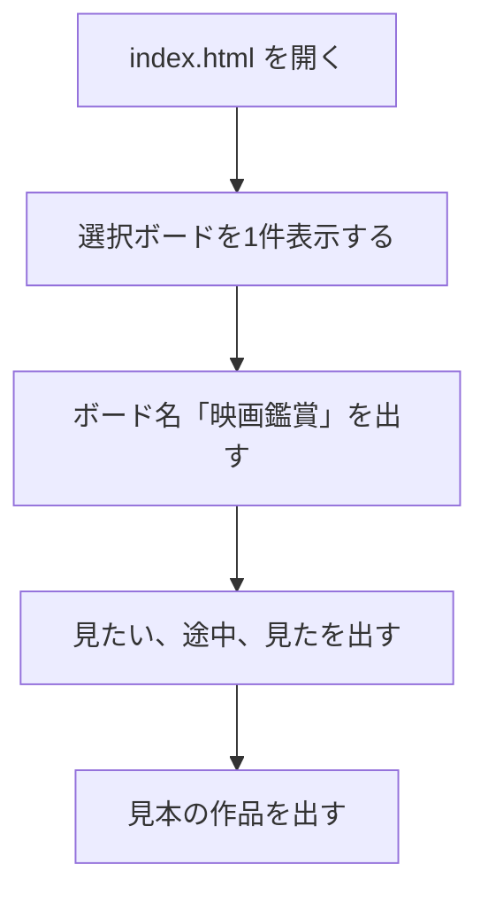
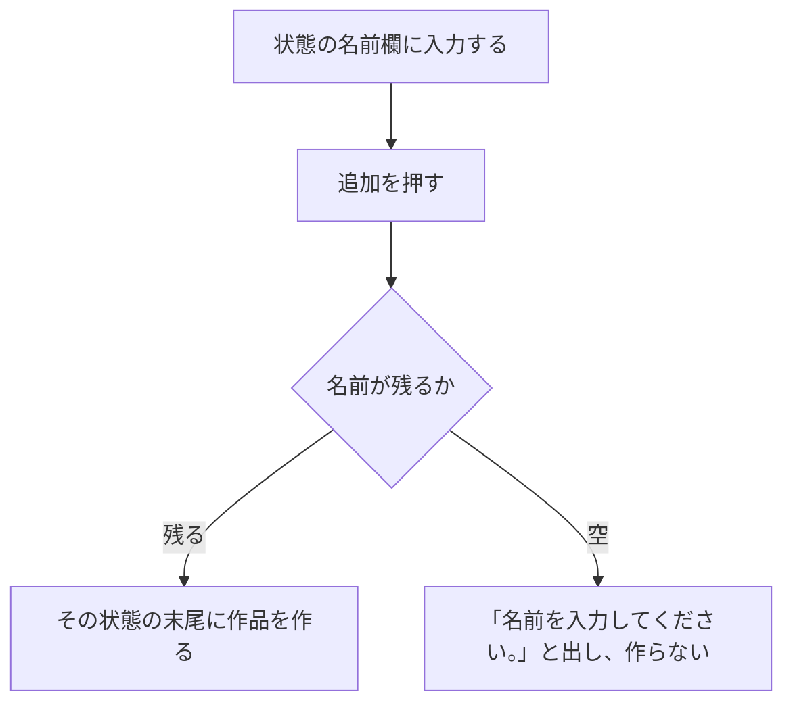
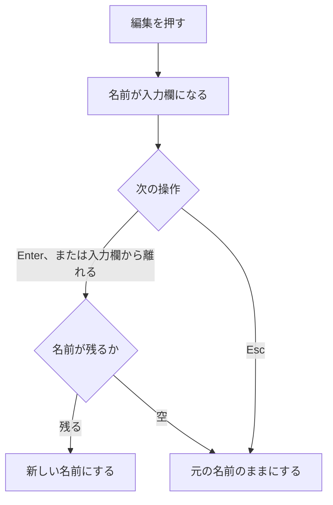
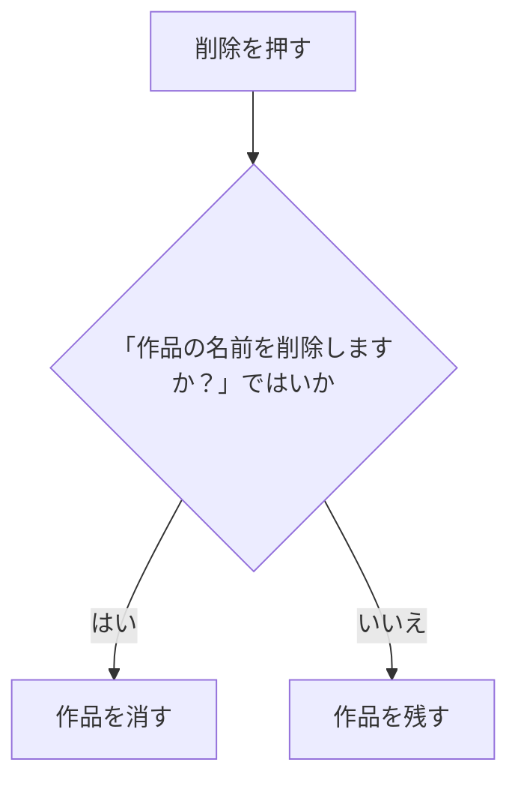
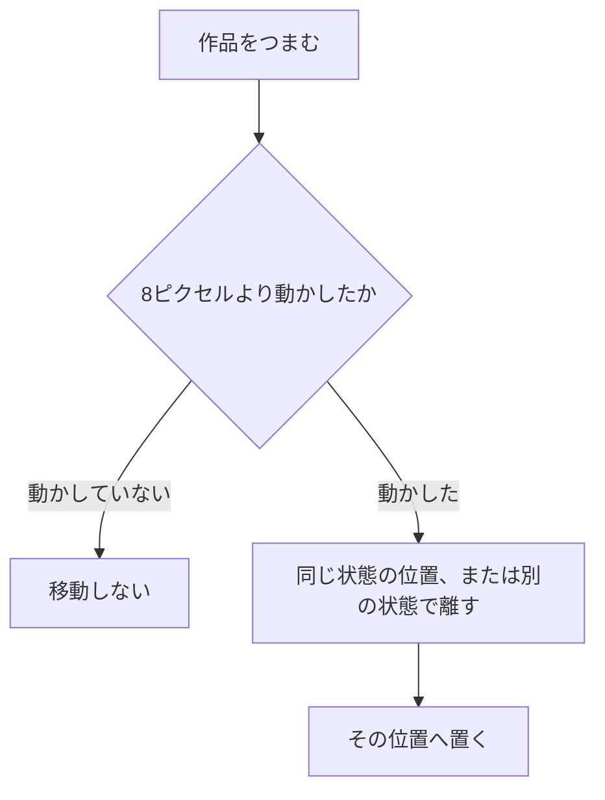

# 機能要件定義書

| 項目 | 内容 |
|---|---|
| 文書名 | 機能要件定義書 |
| 対象システム | 選択ボード |
| 版 | 1.7 |
| 作成日 | 2026年10月9日 |
| 作成者 | nsb |
| 関連資料 | 用語定義書、要件定義書、機能要件、非機能要件、画面設計書、操作手順書、ER図、データベース設計、技術スタック、フォルダ直下の `index.html` |
| 目的 | 利用者が達成できることについて、機能の範囲、流れ、完成の定義をまとめる |

この資料は、機能の約束です。言葉の意味は「用語定義書」に従います。  
何を作るか、何を作らないかの全体は「要件定義書」を正とします。番号（B-1、S-1、W-1 など）も、この版では要件定義書の「この版で作ること」を正とします。

画面は1枚です。作品の編集は、同じ画面の中で名前を入力欄に変えて行います。別のページは開きません。

---

## 1. システムの目的（機能面）

映画を、見たいか、見ている途中か、見終わったかで分けて置く。  
選択ボードは1件で、名前は「映画鑑賞」です。作品を状態の間で移します。

| 項目 | 内容 |
|---|---|
| 対象 | nsb 一人が、手元のブラウザで、作品の進みを見ること |
| 中心の操作 | 作品の表示、追加、編集、削除、つまんで移動。ボード名と状態名は見出しとして出す |
| 残し方 | この版では約束しない。ページを閉じると、見本の並びに戻る |

---

## 2. 利用者と利用の前提

| 項目 | 内容 |
|---|---|
| 利用者 | nsb 一人。ログインはない |
| 説明先 | 提出先。アプリの利用者ではない |
| 画面 | 選択ボードの画面が1枚 |
| 動かす場所 | 自分のパソコンのブラウザで `index.html` を開く |
| 共有 | 他の人との同時利用はない |
| 選択ボードの数 | 1件。ボード名は書き換えない |
| 状態 | 最初から「見たい」「途中」「見た」の3つ。状態名は書き換えない。状態の追加と削除はしない |

---

## 3. 機能の範囲

### 3.1 今回作る機能

| 分類 | できること | 番号 |
|---|---|---|
| 選択ボード | 1件表示する。名前「映画鑑賞」は見出しで、書き換えない | B-1、B-2 |
| 状態 | 「見たい」「途中」「見た」を左から出す | S-1 |
| 作品 | 名前を出す。追加、編集、削除する。つまんで、同じ状態の中の位置、または別の状態へ置く | W-1、W-2、W-3、W-4、W-5 |

最初に見える見本は、見たいに「君の名は。」と「インターステラー」、途中に「三体」、見たに「ショーシャンクの空に」です。

### 3.2 今回作らない機能

要件定義書で対象外としたものです。

- ログイン
- 他の人との共有
- AWS
- Git

保存は、作らないとは決めていません。この版の完成条件には入れません。

---

## 4. 機能と画面の対応

| 分類 | 主な操作 | 画面 |
|---|---|---|
| 選択ボード | 表示。名前は見出し | 選択ボードの画面 |
| 状態 | 3つの見出しを出す | 選択ボードの画面 |
| 作品 | 追加、編集、削除、つまんで移動 | 選択ボードの画面 |

作品をつまんで置く操作は、別のページへ移る操作ではありません。同じ画面の中で、所属する状態と並び順を変えます。少し動かさずに離しても、編集は始まりません。編集は「編集」ボタンで始めます。

この画面のIDは SCR-01 です。配置と部品の正は「画面設計書」です。

---

## 5. 機能ごとの定義

### 5.1 選択ボード

`index.html` を開くと、選択ボードが1件出ます。左上の小さい文字は「選択ボード」、大きい文字は「映画鑑賞」です。ボード名は書き換えません。

### 5.2 状態

「見たい」「途中」「見た」を左から並べます。各状態の上部に名前を出します。名前の書き換え、状態の追加、状態の削除はしません。各状態の下部に、作品の名前を入れる欄と「追加」があります。

### 5.3 作品

作品には名前があります。各作品に「編集」と「削除」があります。

追加は、その状態の欄に名前を入れて「追加」を押します。名前の前後の空白は除きます。残った文字が空なら、「名前を入力してください。」と出し、作品は作りません。作るときは、その状態の末尾に足します。

編集は「編集」を押すと、名前が入力欄になります。Enter、または入力欄から離れると、空でなければ新しい名前になります。空なら、元の名前のままにします。Esc では、元の名前のまま入力をやめます。

削除は「削除」を押すと、「（作品の名前）を削除しますか？」と聞きます。はいなら消します。いいえなら残します。

移動は、作品をつまんで、同じ状態の中の位置、または別の状態へ置きます。ボタン、入力欄の上からつまむことはしません。8ピクセルより小さく動かして離した場合は、移動しません。

---

## 6. ユースフローと操作フロー

ユースフローは、やりたいことを達成する道筋です。操作フローは、画面上の手の動きです。

### 6.1 全体（作品を1件、見たいから見たへ進める）

| 項目 | 内容 |
|---|---|
| 種類 | ユースフロー |
| 対応する機能 | B-1、S-1、W-2、W-3、W-5 |

### 6.2 開く

| 項目 | 内容 |
|---|---|
| 種類 | 操作フロー |
| 対応する機能 | B-1、B-2、S-1、W-1 |

### 6.3 作品を追加する

| 項目 | 内容 |
|---|---|
| 種類 | 操作フロー |
| 対応する機能 | W-2 |

### 6.4 作品を編集する

| 項目 | 内容 |
|---|---|
| 種類 | 操作フロー |
| 対応する機能 | W-3 |

### 6.5 作品を削除する

| 項目 | 内容 |
|---|---|
| 種類 | 操作フロー |
| 対応する機能 | W-4 |

### 6.6 作品を移動する

| 項目 | 内容 |
|---|---|
| 種類 | 操作フロー |
| 対応する機能 | W-5 |

---

## 7. 完成の定義

確認する人は利用者の nsb です。自分のパソコンのブラウザで `index.html` を開きます。

次をすべて満たせば、この版の機能は完成とします。

1. 選択ボードが1件見え、ボード名が「映画鑑賞」である
2. 状態が「見たい」「途中」「見た」の3つで、見本の作品が見える
3. 名前を入れて作品を追加できる。空の名前では作れない
4. 「編集」で名前を直せる。空の名前では元の名前のままになる
5. 「削除」の前に確認し、はいなら作品が消える
6. 作品をつまんで、同じ状態の中の位置、または別の状態へ移せる
7. ボード名と状態名は書き換えられない
8. ページを開き直すと、見本の並びに戻る

ログイン、共有、AWS、Git が無いことは、不合格にしません。

---

## 8. 資料の使い分け

| 資料 | この資料との違い |
|---|---|
| 要件定義書 | 誰が使うか、作らないことを含む全体の約束。番号の正は、この版ではこちら |
| 用語定義書 | 呼び方の辞書。機能の手順そのものではない |
| 機能要件 | 番号で引く確認用の一覧。番号の正は要件定義書。流れと完成の定義は、この資料 |
| ER図 | 選択ボード、状態、作品の関係 |
| データベース設計 | 表の項目と約束。使う製品と、この版で残すかは、まだ決めていない |
| 画面設計書 | 画面の配置と部品。画面IDは SCR-01 |
| 操作手順書 | 開き方と、基本の使い方の手順 |
| 技術スタック | 採用する技術。画面はサーバが HTML を返し、保存は SQLite |
| 非機能要件 | 速さ、残し方、動かす環境など、機能以外の約束 |
| `index.html` | いま動く画面。この資料の流れと違う動きがあれば、画面を直す前にこの資料を直す |

機能の範囲を変えるときは、先に要件定義書を直し、この資料の流れと完成の定義、機能要件の一覧も直します。項目の形を変えるときは、データベース設計も直します。新しい呼び方が必要なら、先に用語定義書へ足します。

---

## 9. 改訂履歴

| 版 | 日付 | 内容 |
|---|---|---|
| 1.0 | 2026年10月9日 | 初版。表示、追加、編集、削除、移動の流れと完成の定義を書いた |
| 1.1 | 2026年10月9日 | 番号の確認用一覧として、機能要件を関連資料に加えた |
| 1.2 | 2026年10月9日 | 選択ボード、状態、作品の関係として、ER図を関連資料に加えた |
| 1.3 | 2026年10月9日 | 機能以外の約束として、非機能要件を関連資料に加えた |
| 1.4 | 2026年10月9日 | 表の項目として、データベース設計を関連資料に加えた |
| 1.5 | 2026年10月9日 | 画面の配置と部品として、画面設計書を関連資料に加えた |
| 1.6 | 2026年10月9日 | 開き方と基本操作として、操作手順書を関連資料に加えた |
| 1.7 | 2026年10月9日 | 採用する技術として、技術スタックを関連資料に加えた |
