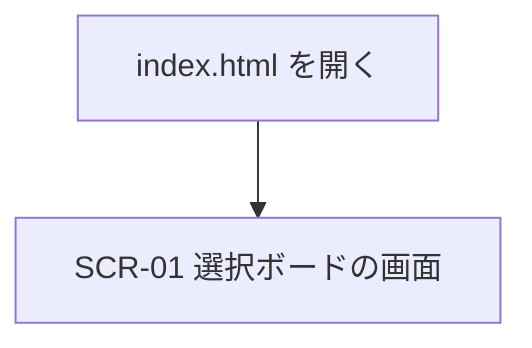

# 画面設計書

| 項目 | 内容 |
|---|---|
| 文書名 | 画面設計書 |
| 対象システム | 選択ボード |
| 版 | 1.1 |
| 作成日 | 2026年10月9日 |
| 作成者 | nsb |
| 関連資料 | 用語定義書、要件定義書、機能要件、機能要件定義書、操作手順書、フォルダ直下の `index.html` |
| 目的 | 画面の配置と、各部品の役割を決める |

言葉の意味は「用語定義書」に従います。作る機能の範囲は「要件定義書」に従います。  
操作の流れは「機能要件定義書」を正とします。

画面IDは、この資料の中で画面を指す番号です。今回の画面は1枚で、IDは SCR-01 です。

---

## 1. 画面一覧

作品の追加、編集、削除、移動は、すべて SCR-01 の中で行います。別の画面は開きません。

| 画面ID | 画面名 | 種類 | 説明 |
|---|---|---|---|
| SCR-01 | 選択ボードの画面 | メイン画面 | `index.html` を開くと出る。状態と作品を操作する |

### 1.1 画面の行き来

`index.html` を開くと、SCR-01 だけが出ます。編集は、作品の名前を同じ場所の入力欄に変えて行います。削除の確認は、ブラウザの確認です。どちらも別の画面ではありません。

作品をつまんで置く操作は、同じ画面の中で、属する状態と位置を変えます。



---

## 2. 選択ボードの画面（SCR-01）

### 2.1 画面レイアウト

状態は3つで、左から「見たい」「途中」「見た」です。横に並びきらないときは、横にスクロールして見ます。

```
+------------------------------------------------------------------+
| 選択ボード                                                       |
| 映画鑑賞                                                         |
| 作品はつまんで移動できます。ページを閉じると元に戻ります。       |
+------------------------------------------------------------------+
| +------------------+  +------------------+  +------------------+ |
| | 見たい           |  | 途中             |  | 見た             | |
| | 作品名           |  | 作品名           |  | 作品名           | |
| | [編集] [削除]    |  | [編集] [削除]    |  | [編集] [削除]    | |
| | [名前] [追加]    |  | [名前] [追加]    |  | [名前] [追加]    | |
| +------------------+  +------------------+  +------------------+ |
+------------------------------------------------------------------+
```

- 画面の背景は、薄いベージュ
- 状態は、生成りの縦長の枠
- 作品は、白い小さな枠
- 状態は3つのまま。横に増やす操作はない

### 2.2 画面上部

| No. | 部品名 | 種類 | 初期値 | 動作 |
|---|---|---|---|---|
| 1 | 種別 | 小さい文字 | 選択ボード | 左上に出す。押しても何も起きない |
| 2 | ボード名 | 見出し | 映画鑑賞 | 種別の下に出す。書き換えない |
| 3 | 説明 | 文字 | 作品はつまんで移動できます。ページを閉じると元に戻ります。 | 押しても何も起きない |

### 2.3 状態

| No. | 部品名 | 種類 | 動作 |
|---|---|---|---|
| 4 | 状態名 | 見出し | 列の上部に出す。初期値は左から「見たい」「途中」「見た」。書き換えない。状態の追加と削除はしない |
| 5 | 作品の並び | 領域 | その状態の作品を、上から並べる。作品が無いときは、この領域は空のまま。空であることを伝える専用の文字は出さない |
| 6 | 名前の入力 | 入力欄 | 各状態の下部にある。その状態へ追加する作品の名前を入れる。文字数の上限は、まだ決めない |
| 7 | 追加 | ボタン | 名前の前後の空白を除き、文字が残れば、その状態の末尾に作品を作る。空なら作品は作らず、部品8を出す |
| 8 | 追加のエラー | 文字 | 「名前を入力してください。」と、暗い赤で出す。名前に文字が残っているときは隠す |

### 2.4 作品

作品の名前を押しても、編集は始まりません。編集は「編集」で始めます。  
作品の枠をつまんで、8ピクセルより大きく動かすと移動を始めます。それより小さく動かして離した場合は、移動しません。ボタンと入力欄の上からつまむことはしません。

| No. | 部品名 | 種類 | 動作 |
|---|---|---|---|
| 9 | 作品の枠 | 枠 | 名前、編集、削除をまとめる。つまんで、同じ状態の中の位置、または別の状態へ置く |
| 10 | 作品の名前 | 文字 | 作品の名前を出す |
| 11 | 編集 | ボタン | 押すと、同じ場所の名前が入力欄になる |
| 12 | 削除 | ボタン | 押すと、ブラウザの確認を出す |
| 13 | 移動先の線 | 線 | 移動を始めているあいだ、置く位置に茶色の線を出す。いまある位置と同じ場所では出さない |

### 2.5 名前の編集

別の画面は開きません。部品10の位置が、入力欄になります。編集中の作品は、つまんで移動しません。

| No. | 部品名 | 種類 | 動作 |
|---|---|---|---|
| 14 | 名前の入力 | 入力欄 | 押したときの名前が入っている。前後の空白は、反映するときに除く |
| 15 | 反映 | キー、または入力欄から離れる | Enter、または入力欄から離れる。残った文字があれば、新しい名前にする。空なら、元の名前のままにする |
| 16 | 取りやめ | キー | Esc。元の名前のまま、入力をやめる |

### 2.6 初期表示

`index.html` を開いた直後は、次のとおりです。ページを閉じると、この並びに戻ります。

| 場所 | 内容 |
|---|---|
| 種別 | 選択ボード |
| ボード名 | 映画鑑賞 |
| 見たい | 「君の名は。」「インターステラー」の順 |
| 途中 | 「三体」 |
| 見た | 「ショーシャンクの空に」 |

---

## 3. 色と見た目

| 対象 | 色 | 意味 |
|---|---|---|
| 画面の背景 | 薄いベージュ | 選択ボード全体 |
| 本文 | 暗い茶色 | ボード名、状態名、作品の名前 |
| 種別と説明 | 茶色がかった灰色 | 補足 |
| 状態 | 生成り。枠線は薄い茶色 | 列 |
| 作品 | 白。枠線は薄い茶色 | 映画1本 |
| 追加のエラー | 暗い赤 | 空の名前 |
| 移動先の線 | 茶色 | 作品を置く位置 |
| ボタン | 白。角は丸い | 編集、削除、追加 |

移動を始めている作品は、薄く表示します。

---

## 4. 確認

| タイミング | メッセージ |
|---|---|
| 作品を削除するとき | 「（作品の名前）」を削除しますか？ |

はいを選ぶと、その作品を消します。いいえを選ぶと、残します。確認を出しているときに Esc を押すと、いいえと同じになります。状態と選択ボードは消しません。

---

## 5. 改訂履歴

| 版 | 日付 | 内容 |
|---|---|---|
| 1.0 | 2026年10月9日 | 初版。選択ボードの画面1枚の配置と部品を書いた |
| 1.1 | 2026年10月9日 | 開き方と基本操作として、操作手順書を関連資料に加えた |
